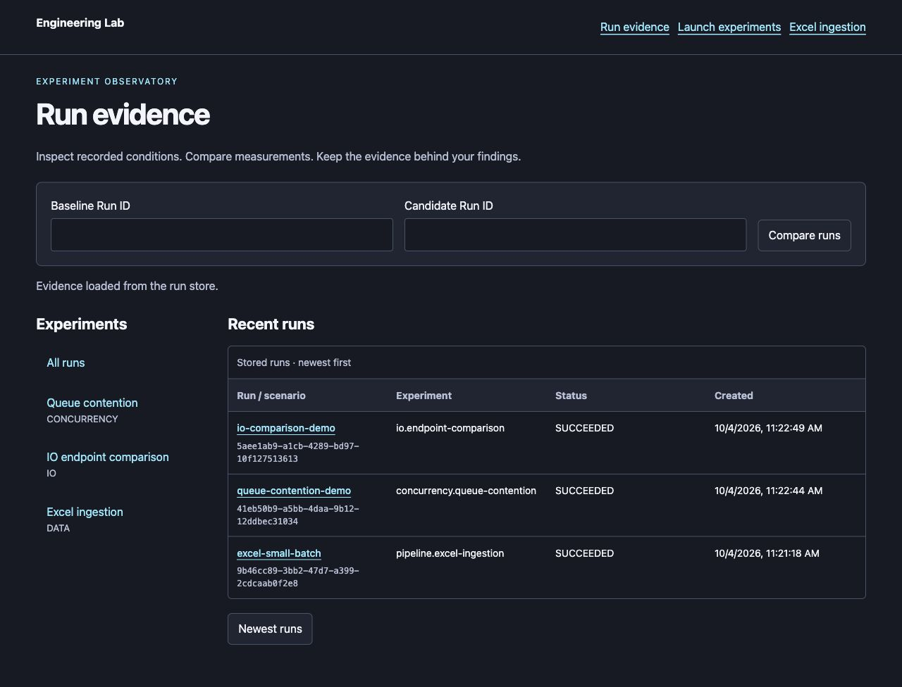
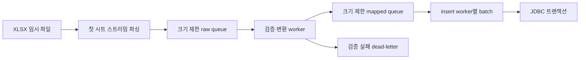

# Engineering Lab

**목적:** 실무에서 마주친 백엔드 문제를 재현 가능한 실험으로 만들고, 가설·조건·결과·해석을 하나의 증거 묶음으로 남겨 기술 판단을 숫자로 설명합니다. 운영용 수집 서비스나 범용 벤치마크가 아니며, 결과는 기록된 환경에서만 유효합니다.

실무 시나리오를 **분야 → 패턴 → 전략·사례**로 탐색하고, 백엔드·JVM·데이터 처리의 가설을 **정의 → 실행 → 관찰 → 비교 → 증거 보존**으로 검증하는 로컬 실험 플랫폼입니다. 루트 플랫폼은 Java 25 / Spring Boot 4 기반이며, Excel 수집·큐 경합·IO 비교의 세 실험군을 제공합니다.

단순히 실행 시간만 출력하지 않고 실행마다 Run ID, 입력·설정, Git 상태, JVM/OS 환경, 메트릭, 결과를 보존합니다. 같은 정의를 반복 실행해 분포로 비교하고, 기준선 대비 회귀를 판정하고, 파라미터를 스윕해 균형점을 찾은 뒤 Finding 문서로 해석을 남길 수 있습니다.



> 독립 대시보드의 패턴 탐색·실행·비교는 **[최신 대시보드 사용법](docs/standalone-dashboard.md)**을, v0.2.0 변경 사항은 [릴리스 기록](docs/releases/v0.2.0.md)을 참고하세요.

> 처음 사용하는 경우 **[화면 캡처 사용 가이드](docs/user-guide.md)**를 따라가세요. 전체 문서는 [문서 안내](docs/README.md)에서 찾을 수 있습니다.

## 저장소 구성

이 저장소에는 최신 실험 플랫폼과 이력서 기반 재현 모듈이 함께 있습니다.

| 경로 | 구성 | 실행 환경 / 테스트 |
| --- | --- | --- |
| 루트 `src/` | Excel·큐·IO 실험 플랫폼, Run UI와 증거 저장 | Java 25 / Boot 4 / `./gradlew test` |
| `career-lab/pipeline-support/` | Excel·Equity·checksum의 bounded batch primitive | Java 21 / 무의존 |
| `career-lab/worker-support/` | 공통 통신·프로세스 라이브러리, 루트 composite 의존성 | Java 21 / Spring 비의존 |
| [`career-lab/`](career-lab/README.md) | equity-system, batch-excel, mcp-platform, mds-distribution, creator-studio | Java 21 / Boot 3.3.4 / Docker / `./scripts/career-lab.sh test` |

Career Lab의 다섯 모듈은 별도 Gradle 다중 프로젝트로 관리합니다.
[모듈별 사용법과 빌드 경계](career-lab/README.md)를 참고하세요.
아래 빠른 시작과 화면 설명은 루트 실험 플랫폼을 대상으로 합니다.
Career Lab을 같은 대시보드에 연결하는 [후속 설계](docs/dashboard-integration-design.md)와
[단계별 계획](docs/dashboard-integration-plan.md)을 작성했으며, worker 통신·프로세스 실행과 중앙 저장 어댑터, [첫 sequence worker 배포물](career-lab/mcp-platform/README.md#별도-jvm-sequence-worker-d4)을 구현했습니다. 첫 sequence 실험의 [선택적 중앙 API 등록](docs/career-worker-deployment.md)을 지원합니다. architecture/validation도 [DB 없는 checks 컨테이너 worker](docs/mcp-checks-worker.md)로 같은 API와 검증 화면에 연결합니다. equity-system의 deletion/redis-lock/registration은 [전용 equity worker](docs/equity-worker.md)로 연동합니다. Batch/Excel의 두 memory 실험도 [독립 JVM memory worker](docs/batch-memory-worker.md)로 공통 화면에 연결합니다. mds-distribution의 settlement-guard/idempotency는 [MDS worker](docs/mds-worker.md)의 CHECK로 확인합니다. creator-studio의 세 시나리오는 [Creator worker](docs/creator-worker.md)로 연결합니다. [대시보드 실행·검증 결과 화면](docs/standalone-dashboard.md#career-sequence-실행과-검증-결과)도 지원합니다. 종료가 확인된 sequence 실행은 [선택적 서버 시작 시 복구](docs/sequence-container-recovery.md#종료-확인-기록이-있는-실행의-시작-시-복구)를 지원하며, 기본값은 비활성입니다.

별도 실행하는 [독립 대시보드 사용 가이드](docs/standalone-dashboard.md)에서 큐·IO 실행, 프리셋 저장·복원, Run 조회·비교·CSV/JSON 내보내기를 사용할 수 있습니다. 기존 실행 화면도 계속 제공합니다. [독립·내장 배포와 기존 URL 전환](docs/dashboard-deployment.md)을 지원하며 기본은 기존 화면 유지입니다.

새 실험을 추가할 때는 [모듈 확장 가이드](docs/adding-experiments.md)를 따릅니다. 기존 세 실험도 모듈별 정의·등록 구조를 사용합니다.

## 목차

- [제공하는 실험과 기능](#제공하는-실험과-기능)
- [빠른 시작](#빠른-시작)
- [사용 화면](#사용-화면)
- [Excel 입력과 처리 방식](#excel-입력과-처리-방식)
- [실행 증거와 데이터 수명](#실행-증거와-데이터-수명)
- [설정](#설정)
- [관측 기능](#관측-기능)
- [성능 검증](#성능-검증)
- [구조와 개발](#구조와-개발)
- [지원 범위와 제한](#지원-범위와-제한)
- [문서](#문서)

## 제공하는 실험과 기능

| 실험 ID | 질문 | 주요 관측 |
| --- | --- | --- |
| `pipeline.excel-ingestion` | 제한된 큐와 병렬 worker가 Excel 처리에 어떤 영향을 주는가? | 읽은/저장한/오류 행, 큐 깊이·대기, 처리량, batch·retry |
| `concurrency.queue-contention` | 생산자와 소비자의 속도 차이가 배압을 어떻게 만드는가? | 생산·소비 수, 최대 큐 깊이, enqueue 대기, blocking 횟수 |
| `io.endpoint-comparison` | virtual-thread와 reactive 대기 방식의 결과는 어떻게 다른가? | 모드별 완료 수·지연·처리량 |

공통 기능:

- 버전 관리되는 JSON/YAML 시나리오와 오프라인 검증, HTTP CLI
- 영속 Run 상태·환경·Git provenance·시계열 메트릭·summary
- 실행 목록·상세·조건 비교·NDJSON export
- 선택적 JVM 표본, 명시적 trace, JFR, Run lifecycle 로그
- JFR·로그 artifact의 크기와 SHA-256 검증 다운로드
- Excel 검증 실패 행의 영속 dead-letter와 페이지 조회
- 재현 가능한 처리량·제한 힙 benchmark 및 원본 증거를 포함한 Finding

## 빠른 시작

### 1. 준비

- JDK **25**와 **21**: 플랫폼은 25로 실행하며 공통 worker 라이브러리 빌드·통합 테스트는 21을 사용합니다. Gradle toolchain이 두 설치를 찾을 수 있어야 합니다.
- 저장소의 Gradle Wrapper 사용: 별도 Gradle 설치는 필요 없습니다. Wrapper는 9.3.1입니다.
- 최초 빌드는 Gradle/Maven 의존성 다운로드를 위한 네트워크가 필요합니다.
- 아래 명령은 저장소 루트의 macOS/Linux `bash` 또는 `zsh` 기준입니다. API 예제는 `curl`을 사용합니다.
- 기본 실험과 테스트에는 Docker, 외부 DB, Node.js 빌드가 필요 없습니다.

macOS에서 JDK를 선택해야 한다면:

```bash
export JAVA_HOME="$(/usr/libexec/java_home -v 25)"
java -version
```

### 2. 테스트와 실행

```bash
./gradlew test
./gradlew bootRun --args='--server.address=127.0.0.1'
```

브라우저에서 [홈](http://localhost:8080/ui)을 엽니다. 로컬 실험용이며 인증·권한 관리가 없으므로 예제는 루프백 주소에 바인딩합니다. 종료는 서버 터미널에서 `Ctrl+C`입니다.

### 3. 첫 실험 실행

서버를 켜 둔 상태에서 다른 터미널을 엽니다.

```bash
./gradlew -q lab --args='list'
./gradlew -q lab --args='validate experiments/concurrency/queue-contention/scenarios/small-buffer.yaml'
./gradlew -q lab --args='run experiments/concurrency/queue-contention/scenarios/small-buffer.yaml --wait'
```

첫 출력에 `runId`, 마지막 출력에 최종 상태와 summary가 나옵니다. 이 예제는 생산자 2개가 각 100개를 만들므로 성공 시 `items.produced=200`, `items.consumed=200`입니다. 지연이나 처리량은 실행 환경에 따라 달라집니다.

[Run evidence](http://localhost:8080/runs/ui)에서 해당 실행을 열어 확인합니다. 서버 주소를 바꿨다면 CLI에 `--server http://localhost:18080`을 추가합니다.

### 4. Excel·IO 예제 실행

```bash
./gradlew -q lab --args='run experiments/pipeline/excel-ingestion/scenarios/small-batch.yaml --wait'
./gradlew -q lab --args='run experiments/io/endpoint-comparison/scenarios/baseline.json --wait'
```

Excel 예제에는 유효 데이터 5행의 XLSX fixture와 checksum이 포함됩니다. 성공 시 `rows.produced=5`, `rows.inserted=5`, `rows.validationErrors=0`입니다. 시나리오의 `input.file`은 **시나리오 파일 디렉터리 기준**입니다.

## 사용 화면

기본 주소는 `http://localhost:8080`입니다.

| 경로 | 역할 | 갱신·보관 방식 |
| --- | --- | --- |
| `/ui` 또는 `/` | 실험군별 진입점과 요약 | 최근 작업 목록의 집계 |
| `/experiments/ui` | 큐·IO 실행 폼, preset, 작업 상세·간편 비교 | 실행은 DB에 보존, preset 이력은 브라우저 |
| `/runs/ui` | registry, 영속 Run 목록·상세·비교·export | 상세는 **Refresh run**으로 갱신 |
| `/ingest/ui` | Excel 실행 목록 | 1초 자동 갱신; 업로드 폼은 없음 |
| `/ingest/ui/{jobId}` | Excel 진행 지표·차트 | 개별 실행 상세 |
| `/ingest/ui/db` | 현재 `ingest_item` 행 조회 | 2초 자동 갱신, 재시작하면 기본 DB는 초기화 |
| `/lab/io/ui` | 브라우저가 직접 호출하는 간편 IO 비교 | 이력은 브라우저 저장소, 영속 Run은 생성하지 않음 |

사용 버튼·읽는 순서·화면별 캡처는 [사용 가이드](docs/user-guide.md)에 있습니다. HTTP 요청은 [API 참조](docs/api-reference.md)를 참고하세요.

## Excel 입력과 처리 방식

`.xlsx`의 첫 번째 시트만 읽고 첫 행(0 기반 row 0)은 헤더로 건너뜁니다. 헤더 이름을 기준으로 열을 찾지 않으며 **열 위치**를 사용합니다.

| 열 | 예시 | 조건 |
| --- | --- | --- |
| A | `a1` | 필수 문자열 `col1` |
| B | `b1` | 필수 문자열 `col2` |
| C | `1` | 정수로 해석 가능한 `col3Int` |

샘플 생성과 업로드:

```bash
./scripts/create-test-xlsx.sh build/test-data/sample.xlsx 500
curl --fail --silent --show-error \
  -F 'file=@build/test-data/sample.xlsx' \
  'http://localhost:8080/ingest/excel?mode=PIPELINE'
```

응답의 `jobId`로 `/ingest/jobs/{jobId}` 또는 `/runs/{jobId}`를 조회합니다. `mode=SINGLE_THREAD`는 단일 스레드 비교용입니다. 생성기는 작은 데모용으로 workbook을 메모리에 만들며, 대량 성능 검증은 별도 benchmark의 streaming fixture를 사용합니다.



- batch는 크기·첫 행 이후 경과 시간·입력 종료 조건으로 flush합니다. SINGLE_THREAD의 시간 조건은 행 callback에서 확인합니다.
- batch 본문의 일시적 DB 오류를 **성공적으로 롤백한 경우**에만 제한된 횟수와 backoff로 재시도합니다. 불확실한 커밋·롤백 오류는 자동 재실행하지 않습니다.
- 검증 실패 행은 저장하지 않고 Run별 dead-letter로 보관합니다. Run 성공과 오류 행 0건은 서로 다른 조건입니다.
- 입력 오류·coordinator 중단 때 이미 받은 행을 제한 시간 안에 drain합니다. 저장/worker 실패는 abort하며 확인된 집계와 미확인 행 수를 남깁니다.
- 같은 파일을 다시 제출하면 새 Run과 새 DB 행을 만듭니다. Run 간 중복 제거는 제공하지 않습니다.

## 실행 증거와 데이터 수명

| 데이터 | 기본 위치 | 서버 재시작 후 |
| --- | --- | --- |
| Run 상태·환경·설정·metrics·summary·dead-letter | `.lab/runs.mv.db` | 유지 |
| 선택적 JFR·Run 로그 | `.lab/jfr/`, `.lab/logs/` | 유지; 자동 삭제 없음. `lab retention`으로 오래된 캡처를 미리 보고, 설정을 켠 경우에만 정리 |
| Excel이 저장한 `ingest_item` | 별도 H2 메모리 DB | 초기화 |
| 업로드 XLSX | 실행 중 임시 파일 | 정상 정리; 원본 자동 보관 없음 |
| CLI 원본 시나리오·작은 fixture | `experiments/` | Git으로 관리 |
| 테스트·benchmark 보고서 | `build/reports/` | `clean`으로 삭제될 수 있음 |

Run은 `QUEUED → RUNNING → SUCCEEDED/FAILED/INTERRUPTED`로 기록됩니다. 재시작 때 남은 QUEUED/RUNNING을 INTERRUPTED로 바꾸며 자동 재실행하지 않습니다. 기존 `/ingest/jobs`·`/experiments/jobs`는 호환상 QUEUED를 RUNNING, INTERRUPTED를 FAILED로 표시합니다.

Git commit/dirty·Java/OS·JVM CPU 수·최대 heap·입력 SHA-256을 metadata에 보존합니다. checksum은 원본 입력 보관을 대신하지 않습니다. 종료 Run의 NDJSON export는 Run·metrics·artifact **참조**를 포함하며 원본 artifact 파일과 dead-letter 전체 행은 별도로 보관해야 합니다.

저장 스키마는 v3입니다. v1/v2 DB를 처음 열 때 자동 DB 백업 후 이행합니다. 업데이트 전 전체 저장 디렉터리 백업과 이전 버전 복원 방법은 [저장 가이드](docs/run-storage.md#v3-이행백업되돌리기)를 따르세요. 신규 등록 실험의 execution 자동 기록과 check 조회·확장 내보내기를 연결했습니다. [확장 API](docs/run-evidence.md)를 참고하세요.

## 설정

기준 파일은 [application.yml](src/main/resources/application.yml)입니다. 다음은 자주 조정하는 기본값입니다. 시나리오 파일의 Excel 파라미터는 실행별 runner에 적용되며 서버의 singleton 설정을 바꾸지 않습니다.

| 키 | 기본값 | 의미 |
| --- | ---: | --- |
| `pipeline.queue.raw-capacity` / `mapped-capacity` | 각각 2000 | 단계 사이 최대 대기 행 |
| `pipeline.threads.validator` / `inserter` | 각각 4 | 검증·저장 worker |
| `pipeline.insert.chunk-size` | 500 | worker별 batch 행 수 |
| `pipeline.insert.flush-interval-ms` | 1000 | partial batch 시간 조건 |
| `pipeline.insert.max-attempts` | 3 | 최초 시도 포함 최대 batch 시도 |
| `pipeline.insert.retry-backoff-ms` | 100 | 지수 backoff 시작값; 최대 60000 ms |
| `pipeline.backpressure.offer-timeout-ms` | 200 | timed offer 대기 |
| `pipeline.error-preview-limit` | 100 | 메모리에 보유할 오류 행 미리보기 |
| `pipeline.shutdown-timeout-ms` | 30000 | drain 및 별도 executor 종료 대기 |
| `lab.retention.apply-enabled` | false | true일 때만 `POST /maintenance/retention`이 오래된 JFR·Run 로그를 삭제. 미리보기는 항상 가능 |
| `lab.series.queue-capacity` | 4 | 대기할 수 있는 반복 묶음 수(1–32). 묶음은 하나씩 실행 |
| `lab.series.run-timeout-ms` | 1800000 | 반복 Run 하나의 최대 대기 시간 |
| `lab.series.poll-interval-ms` | 200 | 반복 Run 종료 확인 간격 |
| `lab.career.creator.enabled` | `false` | Creator 세 시나리오 CONTAINER 등록; worker/MySQL/Redis image ID와 jar hash 필수 ([설정](docs/creator-worker.md)) |
| `lab.career.mds.enabled` | `false` | MDS 두 시나리오 CONTAINER 등록; worker/MySQL image ID와 jar hash 필수 ([설정](docs/mds-worker.md)) |
| `lab.career.memory.enabled` | `false` | batch/excel CONTAINER 등록; worker/MySQL image ID와 jar hash 필수 ([설정](docs/batch-memory-worker.md)) |
| `lab.career.equity.enabled` | `false` | equity 세 시나리오 CONTAINER 등록; worker/MySQL/Redis image ID와 jar hash 필수 ([설정](docs/equity-worker.md)) |
| `lab.career.checks.enabled` | `false` | architecture/validation CONTAINER 등록; 고정 image ID/jar hash 필수 ([설정](docs/mcp-checks-worker.md)) |
| `lab.career.checks.recover-on-startup` | `false` | checks v2 기록을 검증해 시작 시 복구 |
| `lab.career.sequence.execution-kind` | `LOCAL_JVM` | 선택적 Career 실행 방식 (`CONTAINER` 지원) |
| `lab.career.sequence.recover-on-startup` | `false` | 선택한 실행 방식의 기록을 검증해 시작 시 복구 |
| `lab.storage.root` | `.lab` | 실행 증거 디렉터리 |
| `lab.storage.max-active-runs` | 8 | 동시 실행 상한 |
| `lab.storage.preview-limit` | 200 | 최근 metric preview |
| `lab.storage.page-limit` | 500 | Run/metric API 페이지 상한 |
| `spring.servlet.multipart.max-file-size` / `max-request-size` | 각각 50MB | 파일·multipart 요청 한도 |

애플리케이션 staging은 최대 16개/파일당 50 MiB이고 parser는 ZIP entry 1024개, 해제 합계 256 MiB, worksheet 외 metadata 8 MiB, 행당 16384셀·65536문자까지 허용합니다. 실제 수용 크기는 multipart·시나리오·parser 제한을 모두 충족해야 합니다.

실행 시 덮어쓰기 예:

```bash
./gradlew bootRun --args='--server.address=127.0.0.1 --server.port=18080 --lab.storage.root=build/my-lab --pipeline.insert.chunk-size=100'
```

`build/my-lab`은 데모용입니다. 장기 증거를 `build/` 안에 두지 마세요. 설정 범위와 실패 의미는 [시나리오](docs/scenarios.md), [저장](docs/run-storage.md), [운영](docs/operations.md) 문서를 참고하세요.

## 관측 기능

기본적으로 추가 관측은 꺼져 있습니다. 필요한 기능만 선택합니다.

```bash
./gradlew bootRun --args='--server.address=127.0.0.1 --lab.observation.jvm-enabled=true --lab.observation.jvm-interval-ms=1000 --lab.trace.enabled=true --lab.jfr.enabled=true --lab.logs.enabled=true'
```

| 기능 | 기본 상한 | 해석 |
| --- | --- | --- |
| JVM | 주기 표본 최대 1000개 + 시작/종료 | 프로세스 전체 heap·GC·플랫폼 thread |
| Trace | 1000 spans | 전체 실험과 IO 요청; Excel/큐 내부 단계는 미계측 |
| JFR BASIC_V1 | 60초, 최종 파일 16 MiB | CPU load·GC·GC heap summary |
| Run 로그 LIFECYCLE_V1 | 100개 이벤트, 64 KiB | 고정 lifecycle 이벤트; 원문 서버/GC 로그가 아님 |

관측 비용은 실행 시간에 포함될 수 있습니다. JFR BASIC_V1에는 pinning 분석 이벤트·할당 스택이 없습니다. `pinning=true`라는 옵션 이름만으로 현재 JDK에서 carrier pinning이 발생했다고 판단하지 않습니다. 상세 계약은 [관측 가이드](docs/observability.md)에 있습니다.

## 성능 검증

```bash
./gradlew pipelineBenchmark
```

별도 128 MiB JVM에서 단일/병렬 모드를 비교하고 보고서와 Run export를 생성합니다. [측정 방법](docs/pipeline-benchmark.md)과 [2026-10-04 Finding](docs/findings/2026-10-04-pipeline-throughput-heap.md)을 함께 읽으세요.

해당 측정에서 batch당 40 ms 지연은 병렬 처리량 약 3.73배, 지연 없는 H2는 개선 없음이었습니다. 두 모드 모두 10만 행 중 유효 9만 행·오류 1만 건을 보존했습니다. 특정 합성 입력·환경에서의 결과이며 일반적인 성능 우위나 전체 프로세스 RSS 상한을 보장하지 않습니다.

## 구조와 개발

```text
src/main/java/com/pnomeer/lab/
  core/             실험·시나리오·실행·증거 계약
  runtime/          영속 실행, lifecycle, 관측 수집
  storage/          H2 RunStore, bounded metric writer
  registry/         실험 설명과 typed factory
  scenario/         JSON/YAML 검증
  cli/              HTTP CLI
  metrics/          메트릭 모델과 의미·단위 catalog
  experiments/      pipeline, concurrency, io
  app/              HTTP API와 화면
src/main/resources/
  static/run-browser/  Run 목록·상세·비교 UI
  lab/                 evidence 스키마 v1/v2/v3
experiments/           Git 관리 시나리오와 fixture
docs/                  사용·설계·운영·실험 결과
```

Spring 진입점 `EngineeringLabApplication`과 작은 XLSX 생성기도 `com.pnomeer.lab` 아래에 있습니다. Gradle root 이름은 `engineering-lab`이며(v0.2.0까지 `excel-pipeline`), 실제 저장소는 단일 프로젝트입니다. 설계 문서의 향후 모듈 구성을 현재 구현과 혼동하지 않습니다.

```bash
./gradlew test
./gradlew test --tests 'com.pnomeer.lab.experiments.pipeline.*'
./gradlew bootJar
```

`bootJar`는 frontend를 빌드해 대시보드를 jar에 내장하므로 Node가 필요합니다. Node 없이 API만 만들려면 `./gradlew bootJar -PskipFrontend`를 씁니다.

전체 테스트 리포트는 `build/reports/tests/test/index.html`입니다. 2026-10-09 기준 182개 테스트는 파이프라인, 저장·복구, CLI/API, 관측, 제한 힙·제어된 처리량을 다룹니다. 테스트 수는 향후 변경될 수 있습니다.

기여·Codex 작업 규칙은 [AGENTS.md](AGENTS.md), 코드 위치와 검증 방법은 [docs/codex.md](docs/codex.md)를 따릅니다. 작업 단위마다 전체 `./gradlew test`, diff 검토 후 `<type>(<scope>): <영문 요약>` 형식으로 커밋합니다. 사용자 변경을 보존하고 요청 없이 push하지 않습니다.

## 지원 범위와 제한

- 로컬 단일 애플리케이션 소유의 H2 evidence 저장소입니다. 동일 저장 경로를 여러 앱이 동시에 열 수 없습니다.
- 인증·권한·멀티테넌트·공개 서비스 배포 구성이 없습니다.
- 선언적 시나리오는 `SINGLE_PASS`만 지원합니다. 반복·warmup 비교는 별도 benchmark의 기능입니다.
- legacy 작업 목록은 최신 100개, metric은 제한된 preview입니다. 전체 증거는 `/runs` 페이지 API·export를 사용합니다.
- 불확실한 커밋의 재처리, 강제 프로세스 종료 후 큐 복구, Run 간 중복 제거를 보장하지 않습니다.
- 외부 DB/Redis/Kafka 실험, 원문 로그 수집, 자동 보관·삭제, Java Agent는 선택 확장 과제입니다.

## 문서

| 문서 | 내용 |
| --- | --- |
| [문서 안내](docs/README.md) | 목적별 읽는 순서 |
| [사용 가이드](docs/user-guide.md) | 실제 화면 캡처와 단계별 사용법 |
| [API 참조](docs/api-reference.md) | 경로, 요청 예제, 응답·상태·페이지 규칙 |
| [운영·문제 해결](docs/operations.md) | 실행, 백업·복원, 종료, 흔한 오류 |
| [시나리오](docs/scenarios.md) | 정의 schema, CLI, 입력 hash |
| [저장](docs/run-storage.md) / [증거](docs/run-evidence.md) | 영속성·dead-letter·export·artifact |
| [관측](docs/observability.md) | JVM·Trace·JFR·로그 계약 |
| [설계](docs/experiment-platform-design.md) / [계획](docs/implementation-plan.md) | 구현 방향·완료 범위·후속 확장 |
| [Findings](docs/findings/README.md) | 측정 결과와 해석, 작성 템플릿 |


Career sequence의 CONTAINER 배포는 고정 worker/MySQL 이미지 ID와 jar SHA-256이 필요합니다.
controller가 worker·DB·전용 네트워크를 회수하고, opt-in 재시작 복구가 확인된 경우에만
접수를 재개합니다. 중단 Run의 부분 증거는 유지합니다.
[설정과 복구 범위](docs/career-worker-deployment.md#container-실행과-시작-시-복구-i5)를 따르세요.

D6의 [통합 대시보드 운영 가이드](docs/dashboard-operations.md)는 worker 관측 범위, 관리 REPORT 다운로드, workspace 접수 예산, 빌드·시작·정지·복구와 구화면 parity를 정리합니다.

다섯 Career 모듈을 함께 활성화하려면 [전체 모듈 로컬 배포·인수 검증](docs/local-deployment.md)의 준비·시작 스크립트를 사용합니다. 빌드 산출물과 image ID/hash를 고정하고 별도 저장소에 결과를 보존합니다.

릴리스별 변경과 검증 범위는 [CHANGELOG](CHANGELOG.md)와 [v0.1.0 릴리스 기록](docs/releases/v0.1.0.md)을 참고하세요.
