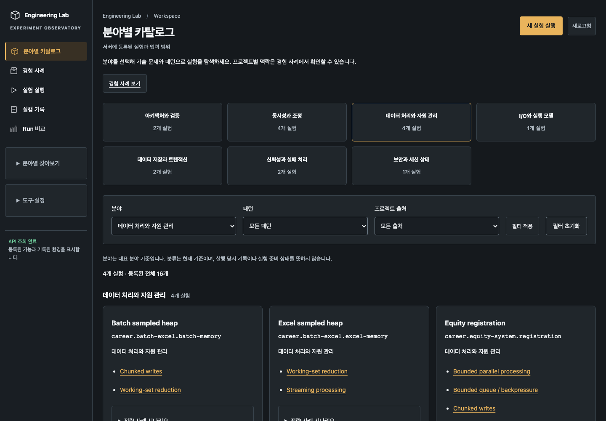
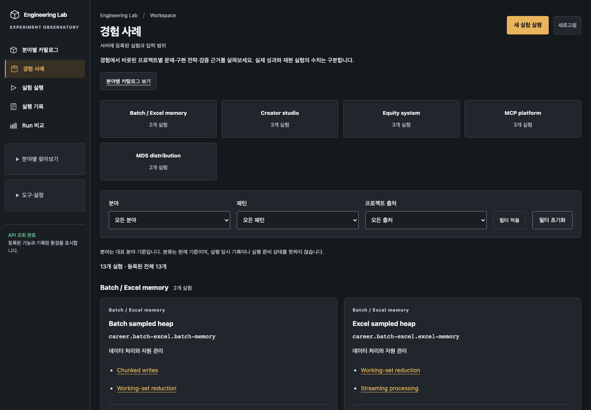
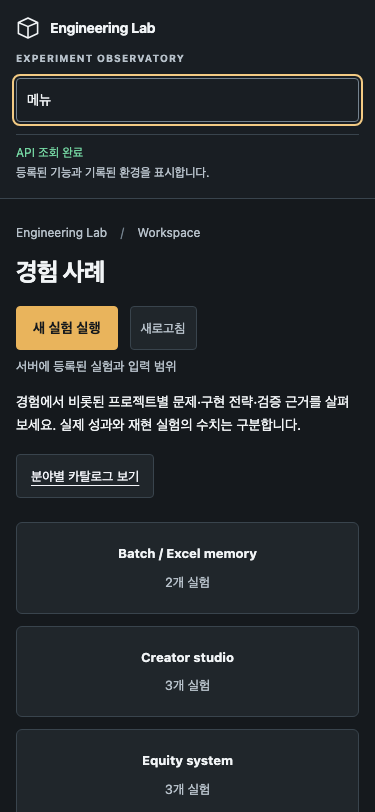

# 분야별 카탈로그와 경험 사례

기본 진입점 `/`, `/app`, `/app/`는 분야별 카탈로그를 연다.
기존 `/app/runs`와 실행·기록·비교 URL은 그대로 유지한다.

## 탐색 구조

- **분야별 카탈로그** `/app/catalog`: 서버의 분야 정의를 첫 화면 카드와 실험 그룹으로 사용한다.
  현재 7개 분야이며, 프로젝트 소유 관계에 상관없이 기존 16개 실험을 기술 문제 중심으로 찾는다.
  패턴은 분야 내부 및 분야 간 탐색을 위한 추가 필터다.
- **경험 사례** `/app/career`: `collection=career`인 모듈만 프로젝트별로 탐색한다.
  현재 5개 프로젝트·13개 실험이며 프로젝트 맥락과 사례의 근거·한계를 확인한다.
  실제 업무 성과와 합성 재현 수치를 구분한다.
- **실험 실행 / 실행 기록 / Run 비교**: 두 탐색 화면이 같은 실행·저장 서비스를 사용한다.
  실험이나 Run을 복제하거나 기존 ID를 변경하지 않는다.
- 사이드바의 **분야별 찾아보기**, **도구·설정**은 접이식이다. 모듈별 개별 실험 링크를
  사이드바에 전부 나열하지 않으므로 실험이 늘어도 기본 메뉴는 늘어나지 않는다.
  모바일에서는 메뉴가 처음에 접혀 있으며 키보드 Enter·Escape로 열고 닫을 수 있다.

카테고리와 프로젝트 카드를 누르면 해당 query로 이동한다. 필터 적용·초기화는 현재
탐색 화면 안에서 동작하며 새로고침/뒤로가기로 선택을 복원한다.
기존 `/app/catalog?source=...` 링크도 계속 지원한다.

## 호환과 확장

분류 API는 탐색과 메뉴가 한 번 조회해 공유한다. 404/미지원 버전은 기존 실험 목록과
출처 필터로 돌아가고, 조회 오류는 화면의 재시도 버튼으로 처리한다.
Career 여부는 서버가 제공하는 module collection을 기준으로 한다. 출처가 없으면
ID 접두어로 추측하지 않으며, 전체 카탈로그에서는 미분류 실험에도 접근할 수 있다.
분야 또는 Career 프로젝트 추가 시 중앙 메뉴 배열이나 실행 API 분기는 필요 없다.

루트/서버 경로 테스트, 기본 탐색·구형 API·모바일·키보드·기존 실행 링크 브라우저 회귀를
`frontend/tests/catalog-navigation.spec.ts`와 기존 patterns/studies/dashboard/design 테스트로 검증한다.

## 검증 기록

frontend 단위 34건, typecheck/production build, 정적 서버 1건 통과.
분야·경험 분리와 기존 패턴/사례/기록 회귀 21건 및 기존 모바일 디자인 회귀 1건 통과.
루트 `./gradlew test` 성공(416개 기존 결과 재사용, 공통 배치 3건 포함 검증).
Career 구현·worker·저장 schema·기존 Run은 변경하지 않는다.
