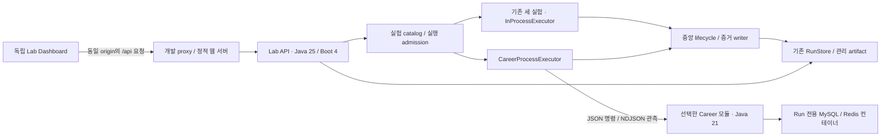

# 공통 대시보드 분리와 Career Lab 연동 설계

상태: **설계안, 구현 전** · 기준 커밋: `2707da8` · 작성: 2026-10-04

실행 계획은 [이행 계획](dashboard-integration-plan.md), 현재 동작은 [API 참조](api-reference.md)와 [Career Lab](../career-lab/README.md)를 따른다. 아래 신규 API·설정·디렉터리는 아직 존재하지 않는다.

## 1. 결정과 범위

독립 프론트엔드 **Lab Dashboard**, 중앙 **Lab API**, 모듈별 **실행 어댑터**로 나눈다. 사용자는 한 화면에서 기존 세 실험군과 Career Lab 다섯 모듈을 탐색하고, 실행하고, 동일한 Run 화면에서 증거를 확인한다.

- 프론트엔드는 별도 프로세스로 실행·빌드·배포한다. 기본 제안은 React + TypeScript + Vite SPA다. 현재 사용 기술로 오인하지 않으며, 구현 시작 시 의존성 버전을 고정한다.
- 현재 Spring Boot 4 앱을 중앙 Lab API로 유지한다. 영속 RunStore, 비교, export, artifact 검증을 재사용한다.
- 기존 세 실험은 현재 JVM에서 실행한다. Career Lab은 Java 21 작업 프로세스로 실행하고 프로토콜로 결과를 전달한다. 다섯 앱을 항상 서버로 띄울 필요가 없다.
- Run 생성·상태·증거 저장의 소유자는 중앙 API 하나다. 브라우저가 각 모듈 DB나 프로세스에 직접 접근하지 않는다.
- 프론트엔드 추출, 실행 계약 도입, 다섯 모듈 연동을 단계별로 진행한다. 기존 화면은 대체 화면의 호환 검증이 끝날 때까지 제공한다.
- 이번 설계는 로컬 단일 사용자 환경이다. 원격 worker, 여러 사용자, 인증, 클러스터 스케줄링은 별도 범위다. 로컬 실행 서비스를 외부에 공개하는 배포는 포함하지 않는다.

## 2. 현재 코드에서 확인한 제약

| 대상 | 현재 구현 | 설계에 주는 영향 |
| --- | --- | --- |
| 홈·실험·Excel·IO 화면 | `HomeController`, `ExperimentController`, `IngestionController`, `IoLabController`의 Java text block | HTML 추출만으로 공통화되지 않음. API 호출·화면 상태·업로드·CSV 기능을 함께 이행 |
| Run 화면 | `static/run-browser/{index.html,app.js,style.css}`와 `RunUiController` | 독립 조회 화면의 첫 이행 대상으로 적합. 상대 API 경로와 query 보존 필요 |
| 실행 등록 | `ExperimentRegistry`가 세 내장 실험의 typed binding 담당 | 외부 실행 어댑터를 별도 경계로 추가해야 함 |
| 실행 환경·관측 | `DurableExperimentRunner.prepare`가 서버 JVM/Git을 기록하고 실행 중 서버 JVM/JFR을 수집 | 이 runner로 자식 프로세스를 단순 감싸면 잘못된 측정 대상이 기록됨 |
| 저장 | 중앙 H2 파일 DB, bounded metric writer, v2 dead-letter schema | 모듈별 DB를 이 DB와 합치지 않음. worker는 H2 파일을 직접 열지 않음 |
| Career Lab | Boot 3.3.4 / Java 21, Testcontainers와 JUnit 테스트로 재현 | Boot 4 classpath에 모듈 jar를 넣지 않음. 실행 harness가 필요 |
| 브라우저 상태 | 프리셋·IO 이력은 localStorage, Run 비교 선택은 sessionStorage | origin 변경 시 자동 승계되지 않음. 이행 동선이 필요 |
| IO 단건 데모 | `/lab/io/*/echo` 호출, 영속 Run 없음 | 화면 이관 중 기록된 benchmark로 의미를 바꾸지 않음 |

프론트엔드만 떼어내서는 Career Lab이 대시보드를 사용할 수 없다. 모듈의 시나리오를 호출하고 구조화된 증거를 만들어주는 어댑터까지 구현해야 한다.

## 3. 목표 구조



목표 디렉터리이며 기존 루트 Java 코드는 이 단계에서 이동하지 않는다.

```text
engineering-lab/
  frontend/                         # 독립 SPA, npm lockfile, 브라우저 테스트
    src/app/                        # navigation, routes, runtime config
    src/features/{catalog,runs,compare,scenarios,legacy}/
    src/panels/                     # 승인된 모듈별 결과 패널
    src/api/                        # 계약 기반 클라이언트, 오류·다운로드 처리
    src/components/                 # 표, 상태, metric chart, 조건 비교
  contracts/
    dashboard/v1/                   # catalog/capability extension, API schema/fixtures
    worker/v1/                      # command/event JSON Schema와 성공·실패 fixture
  src/main/java/com/pnomeer/lab/
    app/                            # 기존 HTTP API와 additive extension
    runtime/                        # in-process / child-process 실행 경계
    storage/                        # 중앙 lifecycle·증거의 유일한 writer
  career-lab/
    worker-support/                 # 신규 Java 21 프로토콜·harness 공통 모듈
    {다섯 모듈}/src/main/.../lab/    # 시나리오 driver, 도메인 서비스 호출
    {다섯 모듈}/src/test/.../        # 기존 회귀·성능 검증 유지
```

`worker-support`는 Boot 4나 루트 Java 25 core jar에 의존하지 않는다. wire schema가 공통 계약이다. Testcontainers를 쓰는 harness는 별도 `labRuntime` source set/배포물에 두어 도메인 앱의 production 의존성과 분리한다. 순수 시나리오 코드는 main에서 재사용하고 테스트와 harness 양쪽이 호출한다. 빌드는 기존 두 wrapper를 유지한다.

### 대안 검토

| 대안 | 판단 |
| --- | --- |
| 화면이 모듈 5개의 REST API에 각각 연결 | 서버·포트·CORS·저장·비교를 중복 관리하게 됨. 채택하지 않음 |
| Boot 4 서버에 모든 모듈을 라이브러리로 통합 | Boot/JDK/DB 설정 충돌, 성능 측정 간섭, 복구 범위 확대. 채택하지 않음 |
| iframe으로 기존 화면 결합 | 임시 링크 제공에는 쓸 수 있으나 catalog·Run·비교가 공통화되지 않음 |
| JUnit XML/콘솔 로그만 수집 | 회귀 결과 첨부에는 유용하나 시계열·조건·측정 구간이 부족. 실험 규약으로 사용하지 않음 |
| 독립 SPA + 중앙 API + 필요할 때 작업 프로세스 | 기존 저장소 재사용, JVM 격리, 중앙 조회 가능. 채택 |

## 4. 프론트엔드와 URL 호환

### 실행 형태

개발 시 Dashboard는 `127.0.0.1:5173`, Lab API는 `127.0.0.1:8080`을 기본 제안으로 사용한다. 브라우저는 Dashboard origin의 `/api/*`만 호출하며 개발 proxy가 `/api`를 제거하고 기존 API로 전달한다. proxy는 고정된 Lab API 대상으로만 전달한다.

별도 배포에서는 정적 웹 서버가 SPA와 `/api` reverse proxy를 제공한다. Vite 개발 서버를 배포 서버로 쓰지 않는다. 같은 프론트엔드 산출물을 선택적으로 Spring 정적 리소스에 포함하는 embedded 배포도 지원하되, SPA 소스를 Java 문자열로 되돌리지 않는다. 기본 `./gradlew test`에 Node 설치를 강제하지 않고 frontend 포함 패키징 task를 분리한다.

- `/app/*`는 신규 화면 경로, `/api/*`는 신규 브라우저 API prefix다.
- 기존 `/runs`, `/experiments`, `/ingest`, `/lab/io`, `/metrics/schema` API는 그대로 유지한다.
- `/api/runs`는 기존 `/runs`로 전달한다. embedded 배포에도 같은 prefix adapter를 제공한다.
- `/runs/ui/options`는 JSON API다. 화면 catch-all에 잡히지 않도록 정확한 API route가 먼저 처리된다.
- SPA fallback은 `/app/*`에만 적용한다. 알 수 없는 `/api/*`에 HTML 200을 반환하지 않는다.
- multipart body, 상태 코드, Content-Disposition, NDJSON streaming, 오류 응답을 proxy에서 보존한다. `Location: /runs/{id}`는 standalone origin에서 `/api/runs/{id}`로 rewrite하며 브라우저는 응답의 runId로 화면을 이동한다.
- runtime config에는 API base path와 capability version만 둔다. 비밀값·worker 경로·Docker 설정은 브라우저에 전달하지 않는다.

### 기존 화면 대응표

| 기존 URL | 신규 화면 | 보존 대상 |
| --- | --- | --- |
| `/`, `/ui` | `/app` | 홈의 세 실험 진입, 최근 작업 + Career 모듈 탐색 |
| `/experiments/ui` | `/app/experiments` | 큐/IO 입력 폼, 프리셋·이력, 비교, CSV |
| `/experiments/ui/{jobId}` | `/app/runs/{jobId}` + 기존 실험 패널 | 작업 ID, 원래 summary·timeline 의미 |
| `/ingest/ui` | `/app/experiments/pipeline.excel-ingestion` | XLSX 업로드, 두 실행 모드 |
| `/ingest/ui/{jobId}` | `/app/runs/{jobId}` + Excel 패널 | 행 집계·오류·큐·insert 진행 |
| `/ingest/ui/db` | `/app/tools/ingestion-db` | 현재 DB 조회는 Run 결과와 별도로 표시 |
| `/lab/io/ui` | `/app/tools/io-echo` | 단건 요청, 브라우저 이력, CSV, 비영속 안내 |
| `/runs/ui?run=...` | `/app/runs/{id}` | 상세 북마크 |
| `/runs/ui?baseline=...&candidate=...` | `/app/compare?baseline=...&candidate=...` | 두 ID·비교 순서 |
| `/runs/ui?experiment=...&before=...` | `/app/runs?experiment=...&before=...` | 실험 필터·페이지 cursor |

GET 화면에만 선택적으로 302 redirect를 사용한다. standalone URL이 설정되지 않았으면 기존 화면을 계속 제공한다. 초기 배포에서 영구 redirect를 쓰지 않으며, rollback 시 설정 한 번으로 기존 화면으로 돌아간다. API·POST 요청은 화면으로 redirect하지 않는다. 신규 URL의 뒤로/앞으로·새로고침·직접 접근을 모두 검증한다.

### 브라우저 저장 데이터

다음 key를 legacy importer의 입력으로 고정한다.

- localStorage: `engineering-lab.experiments.dashboard`, `engineering-lab.experiments.preset-history`, `engineering-lab.io-history`
- sessionStorage: `lab.compare.baseline`, `lab.compare.candidate`

동일 origin에서는 검증된 항목을 신규 versioned key로 복사하고 원본은 유지한다. 다른 origin에서는 이전 페이지에 **설정 내보내기** 버튼을 추가하고 신규 화면에서 JSON 가져오기를 제공한다. 자동으로 읽을 수 있다고 가정하거나 URL에 데이터를 싣지 않는다. import는 1 MiB/최대 100개 항목, schema·타입·문자열 길이 검증과 미리보기를 거치고 충돌 시 기존 값 유지/선택한 항목 교체를 제공한다. 파일·비밀번호·서버 경로는 포함하지 않는다. 비교 ID는 공유 URL로도 전달할 수 있다. 브라우저 저장 불가 상태에서도 폼·실행은 동작해야 한다.

## 5. Dashboard 정보 구조와 확장 방식

기존 어두운 색상과 정보 밀도를 출발점으로 한다. 화면을 모두 새 디자인으로 바꾸는 작업과 구조 분리를 동시에 하지 않는다. 초기에는 Run 화면의 CSS 토큰, 표, 상태 표시, keyboard focus를 옮기고 실험 화면을 차례로 통합한다.

주 탐색은 **실험 / 실행 기록 / 비교 / 도구**다. 실험 목록에서 `플랫폼`과 `Career Lab`으로 묶고, Career Lab 아래 다섯 모듈과 시나리오를 노출한다. 실행 여부는 READY / NOT_BUILT / DOCKER_UNAVAILABLE / INCOMPATIBLE 상태와 사유로 보여준다. 연결되지 않은 모듈에 동작하지 않는 실행 버튼을 제공하지 않는다.

공통 Run 상세:

1. 상태, 실험명, 모듈·variant, Run ID, 조건·가설
2. 측정값 요약 또는 기능 검증 결과
3. 지원되는 경우에만 시계열·trace·JFR·dead-letter 탭
4. 환경·코드·입력·측정 구간, 원시 데이터, export와 artifact

catalog의 `presentation`은 `METRIC_TIMELINE`, `SUMMARY_COMPARISON`, `CHECK_RESULTS`와 승인된 panel ID만 선택한다. 동적 HTML·JavaScript·임의 URL은 허용하지 않는다. 새 panel이 없는 모듈도 공통 summary 표와 원시 증거로 조회 가능하다. 폼은 검증된 scalar parameter schema로 생성하고 XLSX 업로드 등 특수 입력은 등록된 컴포넌트를 사용한다.

기능 검증 결과를 억지로 처리량 그래프로 바꾸지 않는다. 기대한 오류 재현, 중복 방지, 접근 거부는 명명된 check 표에 expected/observed/verdict로 표시한다. 차트에 쓰인 값은 단위·측정 범위·표본 수를 함께 표시하며 원시 표를 제공한다. 결측값은 0으로 대체하지 않는다.

초기 갱신은 HTTP polling이다. 활성 Run 상세를 2초 간격으로 조회하되 이전 요청 완료 후 예약한다. 오류 시 2→4→8→15초로 backoff하고, 탭 비활성·화면 이탈·종료 Run에서는 중지한다. 최신 page와 차트당 최대 2,000 point만 보유하고 raw 전체 데이터는 페이지 조회/export로 제공한다. downsampling은 집계 방식·범위를 표시하며 raw 저장을 대체하지 않는다. SSE/WebSocket은 이 범위의 필수 요건이 아니다.

상태 필터·모듈 선택·비교 ID를 URL에 반영한다. 로딩·빈 결과·접속 실패·부분 데이터 상태를 구분하고, 375px에서도 주요 버튼과 표 접근이 가능해야 한다. 44px 조작 영역, 명시적 label, 색상 외 상태 텍스트, 키보드 탐색·focus 복원을 검증한다.

## 6. API와 데이터 계약

기존 `/runs` 요청·응답, 시나리오 v1, 상태 enum, metric 이름·단위, export 레코드는 보존한다. `/api`는 전달 경로이며 데이터 버전 변경을 뜻하지 않는다. 신규 기능은 별도 versioned extension으로 제공하고 기존 DTO에 필수 필드를 추가하지 않는다.

| 제안 API | 역할 / 호환 규칙 |
| --- | --- |
| `GET /dashboard/v1/capabilities` | protocol version, enabled features, 제한값. 404면 기존 서버 모드로 전환 |
| `GET /dashboard/v1/modules` | module ID, title, readiness와 이유, 지원 experiment ID |
| `GET /dashboard/v1/experiments/{id}` | 기존 descriptor를 참조하는 module/variant/presentation/capability 확장 |
| `GET /dashboard/v1/runs/{id}/execution` | executor 종류, 실제 worker 환경·코드 hash, phase, evidence completeness |
| `GET /dashboard/v1/runs/{id}/checks?after=...&limit=...` | bounded check 결과. 없는 서버는 해당 탭을 제공하지 않음 |

standalone 화면에서는 위 경로 앞에 `/api`를 붙인다. 기존 catalog `/experiments`에는 준비된 career experiment descriptor를 추가하며 상세 확장은 별도 endpoint에서 조회한다. 아직 준비 안 된 시나리오는 modules catalog에서만 설명한다. 옛 화면도 추가 실험의 기본 summary를 읽을 수 있어야 한다.

실험 ID는 `career.<module>.<scenario>`로 고정한다. 기존 `pipeline.excel-ingestion`, `concurrency.queue-contention`, `io.endpoint-comparison` ID는 바꾸지 않는다. variant는 schema에 열거된 parameter다. 최초에는 한 Run이 한 variant를 실행한다. before/after 두 실행을 순차로 만들고 기존 비교 화면에서 선택한다. 원자적 pair 제출·반복 실험 묶음은 별도 확장으로 남긴다.

`POST /runs`는 기존처럼 호출마다 새 Run을 만든다. 클라이언트는 timeout 때 자동 재전송하지 않고 **접수 여부 불명**과 최근 실행 확인 경로를 표시한다. idempotency key를 약속하려면 durable key→Run 매핑을 별도 구현해야 하며, UI 버튼 비활성화를 서버 멱등성으로 간주하지 않는다.

### 저장과 실행 대상 구분

외부 실행을 `DurableExperimentRunner`의 기존 관측 세션에 그대로 넣지 않는다. 공통 admission/lifecycle/evidence writer를 추출하고 `InProcessExecutor`와 `CareerProcessExecutor`가 연결한다. 기존 executor 결과가 바뀌지 않는 회귀 테스트가 선행되어야 한다.

- 기존 `runMetadata.environment/git`은 종전처럼 접수한 플랫폼 환경·코드를 나타낸다. 기존 레코드를 재해석하거나 overwrite하지 않는다.
- 신규 execution extension에는 `executionKind`, `moduleId`, `protocolVersion`, `workerEnvironment`, `workerGit`, `workerArtifactSha256`, `measurementScope`, `phase`, `evidenceComplete`를 저장한다. worker HELLO 이후 실제 값을 불변 등록하며, handshake 전 실패는 unknown으로 남긴다.
- in-process의 유효 측정 환경은 기존 environment다. 외부 실행은 workerEnvironment를 사용한다. worker가 보고한 JDK 21과 서버 JDK 25를 화면에서 구분한다.
- 중앙 비교 API도 실행 환경 extension을 조회해 조건 차이와 주의사항에 포함한다. 기존 비교 UI가 worker 차이를 숨기지 않도록 기존 cautions/conditions 형식으로 내려준다.
- controller JVM의 metric/JFR은 worker 측정으로 표시하지 않는다. 첫 worker는 JVM/JFR 미지원으로 시작할 수 있고, 지원 시 worker 내부 수집과 Run별 관리 artifact 이관까지 구현한다.
- 저장 schema는 additive v3로 execution/check 테이블을 추가한다. metric은 기존 bounded writer와 sequence를 사용한다. 프로토콜 event sequence와 저장 metric sequence는 별개이며, writer가 METRIC에만 저장 sequence를 부여한다. RESULT 검증은 event 종류별 수와 durable metric 수를 각각 확인한다. migration 전 백업, v2→v3 재개방, 실패 rollback을 검증한다. 구버전 서버가 v3 DB를 읽는 rollback은 지원하지 않고 백업 복원 절차를 사용한다. 이때 v3 전환 후 Run은 v2 백업에 없으므로 먼저 export하고 v3 원본 DB도 별도로 보존한다.

## 7. 모듈 실행 어댑터

모듈의 기존 JUnit 메서드를 HTTP로 호출하거나 매 요청마다 Gradle을 실행하지 않는다. 시나리오 준비·실행·측정 코드를 재사용 가능한 driver로 추출하고 JUnit은 같은 driver의 결과를 assert한다. DB seed/reset, Spring context, 테스트용 외부 연동 stub은 harness가 구성한다. 기존 42개 테스트의 기대 동작은 유지한다.

미리 빌드한 worker 배포물의 경로·SHA-256·지원 protocol·experiment ID를 서버 관리 manifest에 등록한다. 시작 명령은 서버가 고정한 Java 실행 파일과 argument 배열로 구성한다. 사용자 입력으로 shell command/classpath/메인 클래스/환경 변수를 바꾸지 못한다. 빌드 누락과 Docker 불가 여부를 admission 전에 확인한다.

### Worker protocol v1 초안

한 프로세스가 한 Run만 수행한다. stdin으로 크기 제한된 JSON 명령 한 줄을 전달하고 부모 생존 감지용으로 파이프를 열어둔다. worker의 별도 제어 reader가 EOF를 감지하면 중단한다. stdout은 protocol NDJSON 전용, stderr는 제한된 진단 로그로 분리한다. Boot banner와 일반 로그를 stdout으로 출력하지 않도록 harness에서 구성한다.

명령의 필수 필드: `protocolVersion`, `runId`, `experimentId`, 검증·기본값 적용된 `parameters`, `definitionSha256`, `deadlineEpochMs`, `seed`, 관리 workspace. 서버의 absolute workspace는 worker에만 전달한다.

이벤트 공통 필드: `protocolVersion`, `runId`, `sequence`, `type`, `payload`. 순서는 HELLO → PHASE/METRIC/CHECK/ARTIFACT → RESULT이며 RESULT는 정확히 한 번 마지막에 온다.

| 이벤트 | 내용 |
| --- | --- |
| HELLO | worker JVM/OS, 코드·배포물 hash, module/protocol. manifest와 불일치 시 거부 |
| PHASE | PREPARING / MEASURING / FINALIZING. 기존 Run status를 늘리지 않는 보조 상태 |
| METRIC | 기존 MetricPoint 모양, 단위 catalog에 등록된 key와 worker 시간 |
| CHECK | checkId, expected/observed, PASS/FAIL, 정해진 설명 필드 |
| ARTIFACT | Run workspace 내 파일의 상대 경로·크기·hash·승인된 종류 |
| RESULT | summary, 종료 이유, 마지막 sequence와 종류별 이벤트 수 |

stdout은 한 레코드 최대 64 KiB, 전체 최대 100,000 이벤트 / 64 MiB 중 먼저 닿는 한도로 시작한다. 문자열/키/label 수도 schema에서 제한한다. 이 수치는 **제안 기본값**이며 구현 시 설정·문서·경계 테스트에 함께 반영한다. unbounded `readLine()`이나 stdout 전체 수집을 사용하지 않는다.

수신자는 runId·엄격 증가 sequence·상태 순서·크기를 검증하고 중앙 저장소에 반영한다. stdout→bounded queue→writer가 막히면 OS pipe까지 배압이 전달된다. backlog로 stdout이 잠시 정지했다고 heartbeat 실패로 오인하지 않는다. 자식 생존 여부와 전체 deadline을 별도로 감시한다. stderr도 동시에 읽어 pipe deadlock을 막고, 최대 1 MiB까지 보관한 뒤 계속 drain하며 초과량·잘림 여부를 기록한다. stdout 프로토콜 오류는 조용히 버리지 않고 Run 실패로 처리한다.

최종 성공 조건은 RESULT 수신, 정상 EOF/exit code 0, 모든 증거 flush와 artifact 검증 완료다. 프로세스 종료 코드만으로 성공 처리하지 않는다. 파이프 중단 시 재연결/재실행하지 않으며 이미 저장된 증거는 부분 결과로 남긴다. 저장 writer의 bounded retry는 동일 sequence로만 재시도한다.

### 수명·용량·실패

접수·저장 완료 시 QUEUED, 실행 슬롯을 얻고 프로세스 시작을 시도하면 RUNNING/PREPARING으로 전이한다. worker PHASE가 측정과 정리를 표시하고 RESULT·exit·저장 확인 뒤 SUCCEEDED/FAILED로 끝난다. 강제 중단은 INTERRUPTED다. 프로세스 시작 실패도 기록된 Run의 FAILED로 남기며 terminal 상태를 뒤집지 않는다.

- 외부 실행은 기본 동시 1개, 대기 4개, 전체 15분, 종료 유예 30초를 제안한다. root의 현재 `max-active-runs: 8`을 조용히 변경하지 않는다. 외부 Run도 전체 admission 한도에 포함한다.
- 벤치마크는 기본적으로 다른 측정 Run과 겹치지 않는 배타 슬롯을 얻는다. DB seed·컨테이너 시작·JIT warmup은 측정 구간 밖으로 두고 실제 구간을 기록한다.
- 모듈별 허용 heap을 manifest에 명시한다. batch-excel 기존 테스트는 2 GiB이므로 일괄 128 MiB로 강제하지 않는다. worker heap + 컨테이너 자원 + 중앙 저장 상한을 별도 산정한다.
- Run마다 DB/Redis 격리를 보장한다. 공유 외부 DB에 seed/delete를 실행하는 모드는 초기 범위에서 제외한다. Docker unavailable이면 새 실행을 거절하되 과거 Run 조회는 가능하다.
- graceful shutdown은 신규 접수를 닫고 기존 실행의 deadline 내 마무리를 기다린다. 초과하면 관리한 자식 프로세스 그룹만 종료하고 INTERRUPTED와 부분 증거를 보존한다.
- 플랫폼 비정상 종료 시 worker는 부모 연결 종료를 감지해 자체 종료한다. 재시작 시 기존 정책대로 QUEUED/RUNNING은 INTERRUPTED로 처리하고 자동 재실행하지 않는다. PID 재사용만으로 다른 프로세스를 죽이지 않도록 owner nonce/workspace lock을 함께 확인한다. 정리 실패 컨테이너·workspace는 식별자와 수동 정리 방법을 남긴다.
- 사용자 취소는 capability가 구현된 executor에만 제공한다. 초기에는 취소 버튼 없이 deadline·서버 종료 처리부터 검증한다. 중단 결과는 기존 INTERRUPTED를 사용한다.
- Run workspace quota 256 MiB, 서버 전체 2 GiB를 초기 제안으로 둔다. admission 예약과 저장 중 검사를 모두 수행한다. 실제 관리 artifact의 개수·다운로드 제한은 기존 상한도 적용한다. quota 소진은 명시적인 실패이며 raw evidence를 몰래 삭제하지 않는다.

로그·check 첨부 파일은 기존 JFR/log 전용 다운로드의 허용 대상을 무작정 확대하지 않는다. 신규 관리 artifact 종류별 validator와 media type, hash 검증, 심볼릭 링크·경로 경계를 추가해야 한다. 참조 전용 파일은 계속 참조 전용으로 표시한다.

## 8. 다섯 모듈의 구체적 연결

아래는 기존 테스트에서 확인한 시나리오를 새 catalog에 연결하는 계획이다. metric/check 이름은 신규 제안이며 측정 전 값을 채워넣지 않는다.

| 모듈 / 제안 experiment suffix | driver 추출 출발점 | 공통 화면에 표시할 결과 |
| --- | --- | --- |
| equity-system / `deletion` | DeletionPerformanceBenchmarkTest | 전체 시간, 최대 단일 트랜잭션 점유 시간, 삭제 건수; 두 시간을 구분 |
| equity-system / `redis-lock` | RedisLockRaceConditionTest | 경쟁 재현·소유권·TTL check, 명시적으로 수집한 이벤트만 timeline |
| equity-system / `registration` | RegistrationPipelineBenchmarkTest | 입력/저장 건수, 처리량·시간, 실제 측정 가능한 배압 지표 |
| batch-excel / `batch-memory` | BatchMemoryBenchmarkTest | tasklet/chunk, 구간별 sampled peak heap, 처리 건수·시간 |
| batch-excel / `excel-memory` | ExcelMemoryBenchmarkTest | XSSF/SXSSF, sampled peak heap, 행 수·파일 크기·시간 |
| mcp-platform / `sequence` | NonAtomic / AtomicUpdate / SelectForUpdateAllocatorConcurrencyTest | 겹친 범위·누락·발급 건수, variant별 정합성 |
| mcp-platform / `architecture` | MainCodeArchitectureTest / ArchitectureViolationDemoTest | 규칙별 정상/고의 위반 검출 check; 런타임 성능과 분리 |
| mcp-platform / `validation` | ValidationPipelineTest | 단계별 허용·거부 check |
| mds-distribution / `settlement-guard` | SettlementGuardTest | 정산 중 수정 차단, TTL 만료 복구 check |
| mds-distribution / `idempotency` | AlbumRegistrationIdempotencyTest | 중복 이벤트, 업무 반영 횟수, 실패 후 재시도 check |
| creator-studio / `session-rotation` | SessionRotationRaceConditionTest | 구 token 거부, refresh 재사용, 세션 수 check |
| creator-studio / `mapping-integrity` | CreatorProducerMappingIntegrationTest | 매핑 변경 승인·거부, 이력·콘텐츠 보존 check |
| creator-studio / `post-commit` | PostCommitEventListenerTest | 커밋 후 호출·rollback 미호출 check; 외부 서비스는 기존 stub 유지 |

예: `career.mcp-platform.sequence`의 variant는 NON_ATOMIC / ATOMIC_UPDATE / SELECT_FOR_UPDATE다. 의도한 충돌을 재현한 baseline은 기대한 관측이므로 그 자체로 인프라 실패가 아니다. CHECK PASS는 기대 동작이 관측됐다는 뜻이고, 성능 향상 판정과도 다르다. 예상과 다른 check는 FAILED, 관측된 baseline 결함은 명확한 expected-anomaly 설명과 함께 기록한다.

ArchUnit은 승인된 패키지·규칙 목록을 harness로 추출한다. 임의 클래스 업로드나 테스트 클래스명 실행 API를 만들지 않는다. 성능 수치는 README 문자열에서 가져오지 않고 실행 결과에서만 표시한다. 각 모듈의 FACT 기반 재현 / NEW-DESIGN 구분을 catalog 설명과 Finding에 유지한다.

## 9. 비교·관측의 정확성

같은 모듈·experiment·metric 의미/단위·입력 checksum·seed·규모·측정 구간·worker 환경·관측 모드가 맞는지 먼저 확인한다. 서로 다른 실험의 저장 결과를 나란히 보는 것은 허용하지만 성능 개선율은 계산하지 않는다. variant만 의도적으로 달라지는 비교인지 표시한다.

heap은 sampled JVM heap이며 RSS나 컨테이너 전체 메모리가 아니다. 서로 다른 JVM의 wall clock으로 trace를 하나로 이어붙이지 않는다. 자식 프로세스의 monotonic elapsed time으로 측정하고 timestamp는 표시용으로 둔다. 프로파일링·컨테이너 설정·warmup·측정 overhead도 실행 조건에 포함한다. 시계열이 없는 check 시나리오에 가짜 그래프를 생성하지 않는다.

## 10. 호환·검증·완료 조건

- 기존 API의 body/status/header, `/runs` cursor, export 마지막 end 레코드, artifact checksum·제한을 계약 테스트로 고정한다.
- 구형 UI→확장 API, 신규 UI→구형 API(capabilities 404), 신규 UI→확장 API 조합을 검증한다. 미지원 기능은 사유와 함께 숨기거나 비활성화한다.
- 기존 H2 v2 데이터를 백업한 fixture를 v3로 열어 기존 Run ID·summary·metrics·artifact가 유지되는지 확인한다.
- 원래 134개 플랫폼 테스트와 Career Lab 42개 테스트를 유지한다. 새 protocol·장애·호환 테스트는 추가한다.
- UI는 기존 모든 경로의 deep link, 프리셋 이행, 업로드, 비교, CSV/NDJSON/JFR/log 다운로드, 키보드·375px 화면을 실제 브라우저로 검증한다.
- worker 테스트는 malformed/초과/누락/중복·역순 이벤트, 비정상 종료, 저장소 실패, 배압, timeout, 부모 종료, 컨테이너 정리, stdout/stderr 포화를 포함한다.
- 최종 완료는 **다섯 모듈의 13개 시나리오와 기존 세 실험군을 하나의 대시보드에서 실행·조회하고 재시작 후 증거를 다시 조회**할 수 있는 상태다. 프론트엔드만 분리한 상태는 중간 완료다.

## 참고 근거

현재 코드와 API 문서가 호환 기준이다. 외부 문서는 도구 동작 확인에 사용했으며 서비스 구조는 이 저장소에 맞춘 설계 결정이다.

- [Vite backend integration](https://vite.dev/guide/backend-integration.html): 독립 asset build와 backend 통합 방식.
- [Vite server options](https://vite.dev/config/server-options.html): 개발 proxy의 구성 경계.
- [MDN localStorage](https://developer.mozilla.org/en-US/docs/Web/API/Window/localStorage): 브라우저 저장소의 origin 경계.
