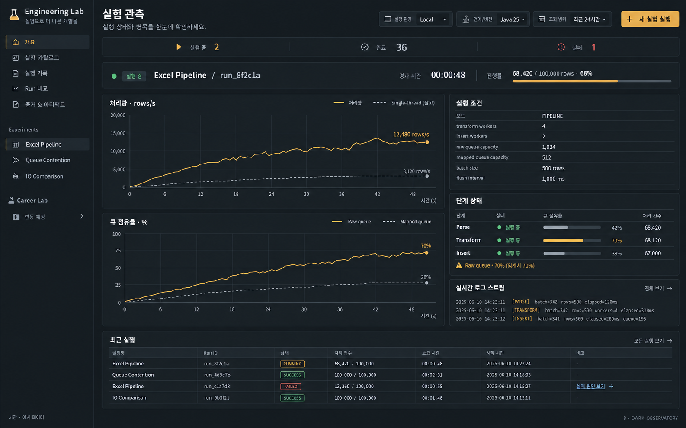

# 실험 대시보드 B안 디자인 명세

작성: 2026-10-05 · 상태: **디자인 방향 선택, UI 구현 전**

Engineering Lab의 공통 대시보드는 B안 **Dark Observatory**를 시각 기준으로 사용한다. 개발자가 실행 상태를 확인하고, 처리량과 큐에서 병목의 단서를 찾고, 기록된 증거로 결과를 검토하는 화면이다. 이 문서는 프론트엔드 구현과 디자인 검수에 필요한 규칙을 정의한다.

실행 구조와 URL 호환은 [통합 설계](dashboard-integration-design.md), 구현 순서는 [이행 계획](dashboard-integration-plan.md), 데이터 계약은 [API 참조](api-reference.md)를 따른다. 아래 조회 주기·표시 임계값·브라우저 예산은 **UI 제안값**이며 서버 기본 설정을 변경하지 않는다.

## 1. 기준 이미지와 적용 범위

ImageGen으로 생성한 검토용 시안이다. 이미지의 수치·날짜·로그·상태명은 예시이며 실제 측정값이나 API 계약이 아니다. 구현에서는 아래 명세를 이미지보다 우선한다. 특히 이미지의 70% 경고는 큐 점유율 주의 표시이며 실제 배압 발생을 뜻하지 않는다.

차콜 배경, 앰버 강조, 얇은 경계선, 밀도 높은 데이터 영역을 공통 방향으로 한다. 실행 관측을 중심으로 카탈로그·기록·비교·증거 화면에 같은 토큰을 적용한다. Career Lab은 실제 capability에 따라 표시하고 미연동 모듈에는 사유를 제공한다.

## 2. 정보 구조와 사용자 흐름

| 메뉴 | 책임 |
| --- | --- |
| 개요 | 실행 중인 Run 선택, 최근 실행과 조회 범위 확인 |
| 실험 카탈로그 | 모듈·시나리오·입력 조건·지원 기능 확인 후 실행 |
| 실행 기록 | 실험·상태·기간 필터, 상세 진입, 비교할 두 Run 선택 |
| Run 비교 | 입력·환경·측정 구간의 일치 여부 확인 후 결과 비교 |
| 증거 및 아티팩트 | metadata, metrics, trace, dead-letter, 관리 파일 조회 |

기본 흐름은 **실험 선택 → 조건 입력 → 제출 → Run 상세 → 결과·증거 확인 → 비교**다. 실험 목록은 catalog에서 구성하고 모듈별 결과 패널은 제공되는 metric·capability를 기준으로 구성한다. 공통 화면에 모듈 이름별 실행 분기를 추가하지 않는다.

실행 중인 Run이 여러 개면 명시적인 선택 목록을 제공하고 자동으로 다른 Run으로 전환하지 않는다. 실행 중인 Run이 없으면 최근 완료 Run과 기록 진입 링크를 표시한다.

## 3. 색상과 타이포그래피

| 토큰 | 값 | 용도 |
| --- | --- | --- |
| canvas | `#15191D` | 전체 배경 |
| surface | `#20262B` | 패널·입력·표 |
| surface-hover | `#2A3239` | 행·버튼 hover |
| border | `#39444D` | 장식 경계·구분선 |
| control-border | `#74828E` | 입력 등 제어 요소의 식별 경계 |
| text-primary | `#F1F4F6` | 제목·주요 값 |
| text-secondary | `#B7C1CA` | 본문·축·보조 설명 |
| text-muted | `#9AA8B4` | 시각·단위·부가 정보 |
| accent | `#E9B45C` | 주 행동·선택·주 시계열 |
| on-accent | `#15191D` | 앰버 버튼 글자 |
| success | `#73D3A0` | 성공·정상 상태 |
| danger | `#FF8C86` | 실패·오류 |
| focus | `#F3CB84` | 키보드 focus ring |

앰버는 행동과 현재 관측 대상에 사용한다. 성공·실패 색은 의미가 있는 위치에만 쓰고 텍스트·아이콘을 함께 표시한다. 장식 경계를 제어 요소의 유일한 식별 수단으로 사용하지 않는다. 실제 색 조합별 일반 텍스트 대비 4.5:1, 큰 텍스트와 제어·상태 그래픽 대비 3:1 이상을 검증한다.

한국어와 일반 UI는 self-hosted Pretendard, 숫자·Run ID·설정·로그는 self-hosted JetBrains Mono를 제안한다. 없으면 시스템 sans-serif/monospace로 표시하며 도입 시 라이선스를 보존한다.

| 항목 | 규칙 |
| --- | --- |
| 화면 제목 | 28px / 36px, weight 700 |
| 패널 제목 | 16px / 24px, weight 600 |
| 본문·표 | 14px / 22px |
| 보조 정보 | 12px / 18px 이상 |
| 주요 수치 | 24px / 32px, tabular numbers |
| 간격 | 4, 8, 12, 16, 24, 32px |
| 모서리 | 기본 4px, 작은 badge 3px |
| 경계·그림자 | 1px 경계, 기본 그림자 없음 |
| 상호작용 | hover/focus 150ms, reduced-motion에서 이동 효과 제거 |

아이콘은 하나의 유지 관리되는 라이브러리를 선택해 기본 18px과 일관된 stroke로 사용한다. 아이콘만 있는 버튼에는 접근 가능한 이름을 제공한다.

## 4. 데스크톱 실행 관측 화면

1440px 이상에서 탐색 216px, 본문 여백 24px, 패널 간격 16px을 기준으로 한다. 본문은 유동 폭이며 1680px까지 확장한다. 차트와 우측 inspector는 약 3:2 비율로 배치한다.

| 순서 | 구성 | 표시 내용 |
| --- | --- | --- |
| 1 | 좌측 탐색 | 브랜드, 공통 메뉴, 실험 모듈, 지원 예정 그룹 |
| 2 | 헤더 | 실험 관측 제목, 환경, 기간 필터, 새 실험 실행 |
| 3 | 요약 strip | 실행 중·성공·실패 수와 집계 범위 |
| 4 | 선택 Run strip | 실험·Run ID·상태·경과 시간·진행 수치 |
| 5 | 관측 본문 | 좌측 처리량·큐 추이, 우측 조건·단계·로그 |
| 6 | 최근 실행 | 실험, Run ID, 상태, 결과 집계, 소요 시간, 시작 시각 |

환경은 관측 대상을 명시한다. 서버 JVM과 향후 Career worker JVM을 `Controller · Java 25`, `Worker · Java 21`처럼 구분한다. 조회 기간은 실행 조건과 분리하며 이미 제출한 Run 설정을 변경하지 않는다.

전역 집계 API가 있을 때만 전체 건수를 표시한다. 현재 페이지 데이터만 있으면 `현재 조회 결과`로 범위를 표시한다. 이 문서가 신규 집계 API 구현 완료를 뜻하지 않는다.

## 5. 데이터와 구성 요소 규칙

### 상태와 진행률

현재 `ExperimentStatus`의 `RUNNING`, `SUCCEEDED`, `FAILED`는 `실행 중`, `성공`, `실패`로 표시한다. 이미지의 `SUCCESS`를 API enum으로 사용하지 않는다. 로딩·연결 끊김·제출 중은 Run lifecycle과 별도로 표현한다. API가 제공하지 않는 대기·취소 상태를 추측하지 않는다.

총량과 분자 정의가 확인된 경우에만 진행률을 계산한다. 파싱 행·검증 완료·저장 확인·실패 행·미확인 행을 구분하고 파싱 완료를 저장 완료로 표시하지 않는다. 총량이 없으면 건수와 경과 시간만 표시한다. 실패 Run도 확인된 집계를 보존하며 부분 결과임을 안내한다.

### 시계열

처리량 축은 `rows/s`, 큐 축은 `%`, 시간 축은 동일 Run의 `경과 시간 (s)`로 표시한다. 집계 구간과 metric 의미는 `/metrics/schema`와 실제 계약에서 확인한다. 순간 처리량과 누적 평균을 혼용하지 않는다.

주 계열은 앰버 실선, 보조 계열은 회색 점선이며 범례·tooltip에 이름·시간·값·단위를 제공한다. 처리량과 큐 축은 0에서 시작하고 큐 점유율은 0–100%로 고정한다. 결측은 선을 끊으며 0으로 채우지 않는다. 차트에는 값 표를 확인하는 경로를 제공한다.

Baseline은 사용자가 선택한 완료 Run이다. 입력·환경·측정 구간의 비교 조건을 확인한 후 표시하고 기준 Run이 없으면 해당 계열을 생략한다. check-only 시나리오는 가짜 차트 대신 check 결과 표를 제공한다. 서로 다른 JVM의 wall clock으로 시계열을 하나로 이어붙이지 않는다.

### 큐와 단계

Raw/Mapped queue별 깊이·설정 용량·점유율을 표시한다. 용량이 없으면 퍼센트를 계산하지 않는다. 단계 건수·상태는 실제 관측값이 있을 때만 표시하며 큐 점유율을 단계 진척으로 변환하지 않는다.

**UI 제안 기준**은 70% 이상 `점유율 주의`, 90% 이상 `용량 근접`이다. 서버 설정이나 배압 판정 기준이 아니다. 배압은 producer 대기 시간 등 계약상 근거가 있을 때만 `배압 관측`으로 표시한다. 점유율만으로 원인을 단정하지 않는다. 경고에는 큐 이름·값·관측 시각을 제공한다.

### 실행 조건과 로그

조건 inspector는 실행 시점의 모드·worker 수·큐 용량·batch size·flush interval·입력 hash·Git provenance·JVM 환경을 표시한다. 긴 값에는 줄바꿈 또는 상세 보기·복사를 제공한다. 재실행은 별도 폼에 조건을 복제한다.

현재 관리 log artifact 다운로드와 실시간 로그 스트림은 별개 기능이다. 스트림 capability가 없으면 `실시간 로그 미지원`과 사용 가능한 artifact 링크를 표시하며 예시 로그를 실제 값처럼 생성하지 않는다. 향후 스트림은 시각·job_id·stage·failure reason, 자동 따라가기 일시정지·필터·누락 안내를 제공한다.

### 기록과 증거

기록은 cursor 페이지 조회를 사용한다. 실패 이유는 상세에서 확인하고 dead-letter는 종료 Run의 지원 API로 페이지 조회한다. 실험별 대표 metric과 단위를 명시하고 없는 값은 `—`로 표시한다. 서로 다른 실험의 처리량을 동등한 값처럼 비교하지 않는다.

아티팩트는 종류·크기·검증 정보·다운로드 가능 여부를 표시한다. 참조만 있는 파일은 다운로드를 비활성화하고 이유를 제공한다. 종료·지원 조건을 만족하는 관리 JFR/log만 다운로드 가능한 것으로 취급한다.

## 6. 상호작용과 예외 상태

| 상황 | 동작과 안내 |
| --- | --- |
| 첫 로딩 | 레이아웃 유지 skeleton, Run 불러오는 중 |
| 기록 없음 | 빈 상태 설명과 카탈로그 진입 |
| metric 없음 | 수집된 시계열이 없습니다, metadata·결과 유지 |
| 조회 오류 | 마지막 정상 데이터 유지, 실패 시각·재시도 버튼 |
| 실행 실패 | 실패 이유, 확인된 집계, 증거·dead-letter 진입 |
| 기능 미지원 | 사유 표시, 실행 불가능한 행동 비활성화 |
| 제출 중 | 중복 클릭 차단, 요청 결과 확인 후 Run 이동 |
| 비교 조건 불일치 | 차이 표시, 개선율 계산 제한, 원시 결과 병렬 조회 유지 |

새 실험 실행은 시나리오·입력·설정이 있는 별도 폼으로 이동한다. 라벨·단위·범위·오류를 입력 옆에 표시하고 기본값은 descriptor에서 읽는다. 최종 실행 버튼으로 Run을 생성한다. 취소·강제 종료는 실제 API 지원이 있을 때만 추가한다.

최근 실행에는 명시적인 상세 링크를 제공한다. 비교 선택은 최대 두 Run이며 baseline/candidate 역할을 확인할 수 있다. query와 기존 상태 호환 정책에 따라 선택을 보존한다.

## 7. 반응형과 접근성

| 폭 | 배치 |
| --- | --- |
| 1440px 이상 | 좌측 탐색과 2열 관측 본문 |
| 1024–1439px | 탐색 192px, 여백 16px, 패널 최소 폭 확보 |
| 768–1023px | 탐색 drawer, 상태 → 조건 → 차트 → 단계 → 로그의 1열 |
| 375–767px | 메뉴 버튼, 요약 2열, 조건 접기, 기록은 핵심 정보 목록 |

모바일 차트는 tick 수를 줄이되 단위·범례를 유지한다. 조건 표의 국소 스크롤은 허용하지만 페이지 전체 가로 스크롤은 만들지 않는다. 로그 원문은 상세 보기로 제공한다.

키보드로 메뉴·필터·선택·링크·다운로드를 조작한다. focus ring은 2px, offset 2px이며 터치 영역은 최소 44×44px다. drawer는 focus 이동·복원과 Escape 닫기를 지원한다. 상태 알림은 의미가 바뀔 때만 전달하고 매 metric 갱신마다 스크린리더를 방해하지 않는다.

## 8. 갱신과 브라우저 메모리 예산

**UI 제안**: 실행 중 조회는 2초 주기부터 시작하고 완료 시 자동 갱신을 중단한다. 같은 조회 요청을 중첩하지 않는다. 오류는 2→4→8초 backoff, 최대 30초로 제한하고 수동 재시도를 제공한다. 숨겨진 탭은 polling을 중단하고 복귀 시 cursor로 이어받는다.

보유 한도는 계열당 원시 point 1,000개, 로그 500줄 및 총 1 MiB, 기록 페이지 50개 행을 초기 제안으로 한다. 한도를 넘으면 오래된 데이터를 제거하며 보유 범위를 알린다. downsampling 시 집계 방식을 밝히고 원본 export를 유지한다. 대규모 Run 전체를 브라우저 메모리에 누적하지 않는다.

Cursor는 API의 nextAfter 의미를 따른다. metric이 비어도 다음 cursor가 있으면 필요한 범위 내에서 계속 조회한다. 마지막 성공 갱신 시각을 표시하고 오래된 값을 실시간처럼 표시하지 않는다.

## 9. 구현 순서와 검수 기준

D1에서는 토큰·탐색 shell·기록·상세·비교의 읽기 화면부터 적용한다. D2에서 기존 실행 폼·업로드·프리셋을 이관한다. 단계별 관측과 실시간 로그는 계약·capability 확보 후 연결한다. 이미지에 있다는 이유로 신규 API를 가정하지 않는다.

- [ ] 색상·밀도·배치가 B안과 일관된다.
- [ ] 실제 catalog·Run·metric 단위·상태 enum을 사용한다.
- [ ] 큐 점유율과 배압, 파싱과 저장 완료를 구분한다.
- [ ] 성공·실패·결측·미지원·조회 오류·부분 결과를 확인한다.
- [ ] 비교 조건 불일치·기준 Run 부재·check-only 결과를 확인한다.
- [ ] 375/768/1024/1440px, 키보드·focus·대비를 브라우저에서 검증한다.
- [ ] 장시간 관측에서 point·로그·요청 수가 한도를 넘지 않는다.
- [ ] 기존 deep link·query·export·artifact·브라우저 상태 호환을 검증한다.
- [ ] UI 구현 시 typecheck/unit/build와 브라우저 확인, 커밋 전 루트 테스트를 실행한다.

현재 산출물은 디자인 명세와 기준 이미지다. 실제 UI 적용·브라우저 검증·실시간 로그 구현 완료를 뜻하지 않는다.
