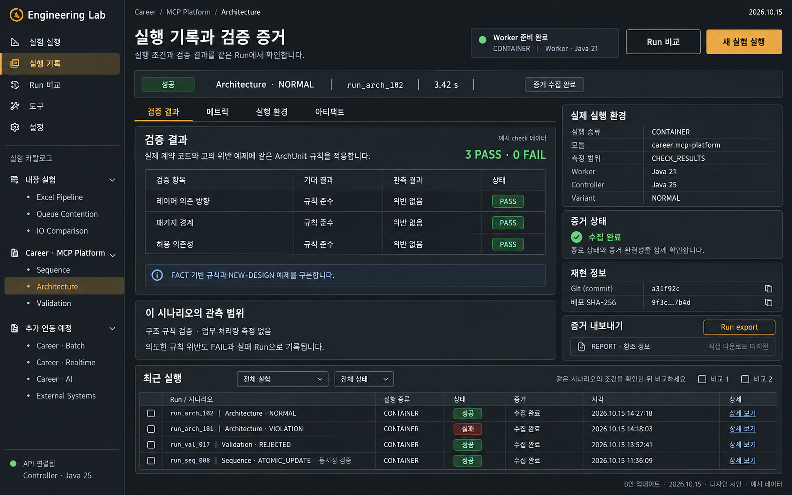

# 실험 대시보드 B안 디자인 명세

작성: 2026-10-05 · 갱신: 2026-10-16 · 상태: **B안 탐색·검증·환경 배치 적용, 확장 관측은 capability 기준**

Engineering Lab의 공통 대시보드는 B안 **Dark Observatory**를 시각 기준으로 사용한다. 개발자가 실행 조건·검증 결과·증거 완결성을 함께 확인하는 화면이다. 처리량·큐를 관측하는 실험과 check 중심 실험은 같은 탐색 구조 안에서 서로 다른 결과 패널을 사용한다. 이 문서는 프론트엔드 구현과 디자인 검수에 필요한 규칙을 정의한다.

실행 구조와 URL 호환은 [통합 설계](dashboard-integration-design.md), 구현 순서는 [이행 계획](dashboard-integration-plan.md), 데이터 계약은 [API 참조](api-reference.md)를 따른다. 아래 조회 주기·표시 임계값·브라우저 예산은 **UI 제안값**이며 서버 기본 설정을 변경하지 않는다.

## 1. 기준 이미지와 적용 범위

2026-10-15에 ImageGen으로 생성한 검토용 시안이다. 이미지의 수치·날짜·check 항목·Run ID는 예시다. 화면 배치의 기준으로 사용하되 실제 catalog·API 계약과 아래 명세를 우선한다. [초기 처리량 관측 시안](images/dashboard-dark-observatory-concept.png)은 시계열 실험의 배치 참고로 보존한다.

차콜·앰버 토큰은 유지하고, 최신 기준 화면은 **실행 기록과 검증 증거**로 변경한다. 독립 React 대시보드의 실행·조회·비교·설정과 Worker 실행 증거 기능을 시각적으로 정리하는 개편이다. 기능 구현 상태는 [이행 계획](dashboard-integration-plan.md)에서 확인한다.

이미지의 `Career · Batch`, `Career · Realtime`, `Career · AI`, `External Systems`는 실제 모듈 정의가 아니다. 구현에 복사하지 않는다. Equity 등 연동된 모듈도 이미지에 없다는 이유로 숨기지 않는다. 서버에서 반환한 catalog와 capability를 기준으로 구성하며 등록되지 않은 모듈을 실행 가능한 것처럼 표시하지 않는다.

## 2. 정보 구조와 사용자 흐름

| 메뉴 | 책임 |
| --- | --- |
| 실험 실행 | catalog에서 시나리오 선택, 준비 상태 확인, 조건 입력·제출 |
| 실행 기록 | 실험 필터, Run 선택, 검증·메트릭·환경·아티팩트 조회 |
| Run 비교 | 입력·환경·측정 구간의 일치 여부 확인 후 결과 비교 |
| 도구 | ingestion DB 조회와 비영속 IO 데모 |
| 설정 | 브라우저 설정과 기존 상태 가져오기·내보내기 |

좌측 탐색은 공통 메뉴 아래에 catalog를 모듈별로 묶는다. 내장 Excel·Queue·IO와 등록된 Career 실험을 구분하며 선택한 시나리오를 앰버로 표시한다. 모듈별 입력·결과 어댑터는 유지하되 공통 탐색에 이름별 실행 분기를 추가하지 않는다.

기본 흐름은 **실험 선택 → 준비 상태 확인 → 조건 입력 → 제출 → Run 상세 → 결과·증거 확인 → 비교**다. 실행 기록과 상세는 구분된 경로를 유지한다. 시안 하단의 최근 실행 영역은 상세에서 관련 Run으로 이동하는 보조 목록이며 전체 기록 화면을 대체하지 않는다.

실행 중인 Run이 여러 개면 명시적인 선택 목록을 제공하고 자동으로 다른 Run으로 전환하지 않는다. 실행 중인 Run이 없으면 최근 완료 Run과 기록 진입 링크를 표시한다.

## 3. 색상과 타이포그래피

| 토큰 | 값 | 용도 |
| --- | --- | --- |
| canvas | `#15191D` | 전체 배경 |
| surface | `#20262B` | 패널·입력·표 |
| surface-hover | `#2A3239` | 행·버튼 hover |
| border | `#39444D` | 장식 경계·구분선 |
| control-border | `#74828E` | 입력 등 제어 요소의 식별 경계 |
| text-primary | `#F1F4F6` | 제목·주요 값 |
| text-secondary | `#B7C1CA` | 본문·축·보조 설명 |
| text-muted | `#9AA8B4` | 시각·단위·부가 정보 |
| accent | `#E9B45C` | 주 행동·선택·주 시계열 |
| on-accent | `#15191D` | 앰버 버튼 글자 |
| success | `#73D3A0` | 성공·정상 상태 |
| danger | `#FF8C86` | 실패·오류 |
| focus | `#F3CB84` | 키보드 focus ring |

앰버는 행동과 현재 관측 대상에 사용한다. 성공·실패 색은 의미가 있는 위치에만 쓰고 텍스트·아이콘을 함께 표시한다. 장식 경계를 제어 요소의 유일한 식별 수단으로 사용하지 않는다. 실제 색 조합별 일반 텍스트 대비 4.5:1, 큰 텍스트와 제어·상태 그래픽 대비 3:1 이상을 검증한다.

한국어와 일반 UI는 self-hosted Pretendard, 숫자·Run ID·설정·로그는 self-hosted JetBrains Mono를 제안한다. 없으면 시스템 sans-serif/monospace로 표시하며 도입 시 라이선스를 보존한다.

| 항목 | 규칙 |
| --- | --- |
| 화면 제목 | 28px / 36px, weight 700 |
| 패널 제목 | 16px / 24px, weight 600 |
| 본문·표 | 14px / 22px |
| 보조 정보 | 12px / 18px 이상 |
| 주요 수치 | 24px / 32px, tabular numbers |
| 간격 | 4, 8, 12, 16, 24, 32px |
| 모서리 | 기본 4px, 작은 badge 3px |
| 경계·그림자 | 1px 경계, 기본 그림자 없음 |
| 상호작용 | hover/focus 150ms, reduced-motion에서 이동 효과 제거 |

아이콘은 하나의 유지 관리되는 라이브러리를 선택해 기본 18px과 일관된 stroke로 사용한다. 아이콘만 있는 버튼에는 접근 가능한 이름을 제공한다.

## 4. 데스크톱 실행 기록과 검증 화면

1440px 이상에서 탐색 220px, 본문 여백 24px, 패널 간격 16px을 기준으로 한다. 본문은 유동 폭이며 1680px까지 확장한다. 결과 본문과 우측 inspector는 약 65:35 비율이다.

| 순서 | 구성 | 표시 내용 |
| --- | --- | --- |
| 1 | 좌측 탐색 | 공통 메뉴, catalog 모듈·시나리오, API 연결 상태 |
| 2 | 헤더 | 모듈·시나리오 breadcrumb, 제목, 준비 상태, 비교·새 실행 |
| 3 | 선택 Run strip | 상태, 시나리오·variant, Run ID, 경과 시간, 증거 상태 |
| 4 | 결과 탭 | 검증 결과, 메트릭, 실행 환경, 아티팩트 |
| 5 | 결과 본문 | check 표 또는 시계열·집계, 관측 범위 설명 |
| 6 | 우측 inspector | 실제 실행 환경, 증거 완결성, 재현 정보, 내보내기 |
| 7 | 최근 실행 | 실험·Run, 실행 종류, 상태, 증거, 시각, 상세 링크 |

측정 범위가 `CHECK_RESULTS`인 실행은 검증 결과를 기본 보기로 연다. 내장 `IN_PROCESS` 실행은 메트릭을 주 결과로 배치한다. `전체`·`검증 결과`·`메트릭`·`실행 환경`·`아티팩트` 버튼으로 전환하며 숨긴 영역의 데이터와 cursor를 유지한다. 검증 결과 보기에서도 우측 환경·증거·재현 inspector를 함께 제공한다. 미지원 탭은 사유와 함께 비활성화하거나 숨긴다. 검증 정보가 없는 구형 Run을 실패나 PASS로 해석하지 않는다.

실제 환경은 선택한 Run의 기록에서 읽는다. 실행 종류 `IN_PROCESS`·`LOCAL_JVM`·`CONTAINER`, 모듈, 측정 범위, 마지막 기록 단계, Worker JVM·OS·Git·배포 SHA-256을 표시한다. Controller 정보는 별도 라벨로 제공하며 Worker 정보가 없다고 서버 환경으로 대체하지 않는다.

헤더 준비 상태는 현재 시나리오의 실행 가능 여부다. 과거 Run의 성공·실패 또는 당시 환경을 뜻하지 않는다. 상세에서 이 상태를 노출하면 현재 확인 시각과 다시 확인 행동을 제공하고, 실제 실행 폼의 readiness gate와 같은 응답을 사용한다.

전역 집계 API가 없는 요약 건수는 표시하지 않는다. 최근 실행 필터와 상태 필터는 실제 API 또는 조회된 페이지의 범위에 맞추고, 클라이언트 필터라면 `현재 페이지`라고 명시한다.

## 5. 데이터와 구성 요소 규칙

### 상태와 진행률

현재 `ExperimentStatus`의 `RUNNING`, `SUCCEEDED`, `FAILED`는 `실행 중`, `성공`, `실패`로 표시한다. Run 상태와 개별 check 판정은 서로 다른 열과 badge로 표시한다. 로딩·연결 끊김·제출 중은 Run lifecycle과 별도로 표현한다. API가 제공하지 않는 대기·취소 상태를 추측하지 않는다.

총량과 분자 정의가 확인된 경우에만 진행률을 계산한다. 파싱 행·검증 완료·저장 확인·실패 행·미확인 행을 구분하고 파싱 완료를 저장 완료로 표시하지 않는다. 총량이 없으면 건수와 경과 시간만 표시한다. 실패 Run도 확인된 집계를 보존하며 부분 결과임을 안내한다.

### 검증 결과와 증거 완결성

Check 표는 check ID·설명, 기대값, 관측값, 판정을 제공한다. 긴 관측값은 상세 펼치기를 제공하고 값을 잘라서 의미를 잃지 않게 한다. check API의 cursor로 페이지를 이동하며 종료 전에는 `실행 종료 후 검증 결과를 조회합니다`를 표시한다.

PASS는 기록된 기대값 충족을 뜻한다. Validation에서 예상한 입력 거절이나 Sequence에서 의도한 이상 재현도 기대값에 따라 PASS일 수 있다. Architecture의 고의 위반 variant는 규칙별 FAIL과 실패 Run을 남긴다. FACT 기반 규칙과 NEW-DESIGN 예제의 구분, 고정 입력·측정 범위 설명을 시나리오별로 제공한다. Sequence BEFORE의 재현용 지연을 업무 성능 개선율로 해석하지 않는다.

`3 PASS · 0 FAIL` 같은 집계는 전체 check 수가 확보됐을 때만 전체 요약으로 표시한다. 페이지 일부만 조회했다면 `현재 페이지`를 명시한다. 빈 페이지·미지원·조회 오류를 모두 통과로 표시하지 않는다.

`evidenceComplete`는 Run 성공 여부와 분리한다. 실패 Run도 증거 수집이 완료될 수 있다. 미완료는 `증거 미완료 · 확인된 부분만 표시`, 확장 정보 부재는 `확장 실행 정보 없음`으로 표시한다. `phase`는 마지막 기록 단계이며 전체 진행률로 변환하지 않는다.

### 실행 준비 상태

| 응답 | 표시와 행동 |
| --- | --- |
| READY | 실행 준비 완료, 설정·실행 허용 |
| NOT_BUILT | worker 배포 파일 없음, 다시 확인 제공 |
| INCOMPATIBLE | worker 배포 확인 필요, 다시 확인 제공 |
| DOCKER_UNAVAILABLE | Docker 준비 필요, 다시 확인 제공 |
| 확인 중 | 확인 중 안내, 최대 75초 안내, 실행 차단 |
| 오류·알 수 없는 값 | 오류 또는 미지원 상태 안내, 실행 차단·재확인 |

준비되지 않았어도 저장된 기록 조회는 계속 제공한다. capability 미지원과 서버 오류를 구분하고 서버 장애를 기존 API 호환 모드로 숨기지 않는다.

### 시계열

처리량 축은 `rows/s`, 큐 축은 `%`, 시간 축은 동일 Run의 `경과 시간 (s)`로 표시한다. 집계 구간과 metric 의미는 `/metrics/schema`와 실제 계약에서 확인한다. 순간 처리량과 누적 평균을 혼용하지 않는다.

주 계열은 앰버 실선, 보조 계열은 회색 점선이며 범례·tooltip에 이름·시간·값·단위를 제공한다. 처리량과 큐 축은 0에서 시작하고 큐 점유율은 0–100%로 고정한다. 결측은 선을 끊으며 0으로 채우지 않는다. 차트에는 값 표를 확인하는 경로를 제공한다.

Baseline은 사용자가 선택한 완료 Run이다. 입력·환경·측정 구간의 비교 조건을 확인한 후 표시하고 기준 Run이 없으면 해당 계열을 생략한다. check-only 시나리오는 가짜 차트 대신 check 결과 표를 제공한다. 서로 다른 JVM의 wall clock으로 시계열을 하나로 이어붙이지 않는다.

### 큐와 단계

Raw/Mapped queue별 깊이·설정 용량·점유율을 표시한다. 용량이 없으면 퍼센트를 계산하지 않는다. 단계 건수·상태는 실제 관측값이 있을 때만 표시하며 큐 점유율을 단계 진척으로 변환하지 않는다.

**UI 제안 기준**은 70% 이상 `점유율 주의`, 90% 이상 `용량 근접`이다. 서버 설정이나 배압 판정 기준이 아니다. 배압은 producer 대기 시간 등 계약상 근거가 있을 때만 `배압 관측`으로 표시한다. 점유율만으로 원인을 단정하지 않는다. 경고에는 큐 이름·값·관측 시각을 제공한다.

### 실행 조건과 로그

조건 inspector는 실행 시점의 모드·worker 수·큐 용량·batch size·flush interval·입력 hash·Git provenance·JVM 환경을 표시한다. 긴 값에는 줄바꿈 또는 상세 보기·복사를 제공한다. 재실행은 별도 폼에 조건을 복제한다.

현재 관리 log artifact 다운로드와 실시간 로그 스트림은 별개 기능이다. 스트림 capability가 없으면 `실시간 로그 미지원`과 사용 가능한 artifact 링크를 표시하며 예시 로그를 실제 값처럼 생성하지 않는다. 향후 스트림은 시각·job_id·stage·failure reason, 자동 따라가기 일시정지·필터·누락 안내를 제공한다.

### 기록과 증거

기록은 cursor 페이지 조회를 사용한다. 실패 이유는 상세에서 확인하고 dead-letter는 종료 Run의 지원 API로 페이지 조회한다. 실험별 대표 metric과 단위를 명시하고 없는 값은 `—`로 표시한다. 서로 다른 실험의 처리량을 동등한 값처럼 비교하지 않는다.

아티팩트는 종류·크기·검증 정보·다운로드 가능 여부를 표시한다. 참조만 있는 파일은 다운로드를 비활성화하고 이유를 제공한다. 종료·지원 조건을 만족하는 관리 JFR/log만 다운로드 가능한 것으로 취급한다. REPORT는 참조 정보로 표시하고 직접 다운로드를 제공하지 않는다. 확장 export가 지원되는 종료 Run은 실행·검증 포함 NDJSON을 제공하며 원본 파일 다운로드와 구분한다.

## 6. 상호작용과 예외 상태

| 상황 | 동작과 안내 |
| --- | --- |
| 첫 로딩 | 레이아웃 유지 skeleton, Run 불러오는 중 |
| 기록 없음 | 빈 상태 설명과 카탈로그 진입 |
| metric 없음 | 수집된 시계열이 없습니다, metadata·결과 유지 |
| 조회 오류 | 마지막 정상 데이터 유지, 실패 시각·재시도 버튼 |
| 실행 실패 | 실패 이유, 확인된 집계, 증거·dead-letter 진입 |
| 기능 미지원 | 사유 표시, 실행 불가능한 행동 비활성화 |
| 제출 중 | 중복 클릭 차단, 요청 결과 확인 후 Run 이동 |
| 비교 조건 불일치 | 차이 표시, 개선율 계산 제한, 원시 결과 병렬 조회 유지 |

새 실험 실행은 시나리오·입력·설정이 있는 별도 폼으로 이동한다. 라벨·단위·범위·오류를 입력 옆에 표시하고 기본값은 descriptor에서 읽는다. 최종 실행 버튼으로 Run을 생성한다. 취소·강제 종료는 실제 API 지원이 있을 때만 추가한다.

최근 실행에는 명시적인 상세 링크를 제공한다. 비교 선택은 최대 두 Run이며 baseline/candidate 역할을 확인할 수 있다. query와 기존 상태 호환 정책에 따라 선택을 보존한다.

## 7. 반응형과 접근성

| 폭 | 배치 |
| --- | --- |
| 1440px 이상 | 좌측 탐색과 2열 관측 본문 |
| 1024–1439px | 탐색 192px, 여백 16px, 패널 최소 폭 확보 |
| 768–1023px | 탐색 drawer, Run 상태 → 결과 탭·본문 → 환경·증거 → 최근 실행의 1열 |
| 375–767px | 메뉴 버튼, Run strip 줄바꿈, 결과·환경 1열, 기록은 핵심 정보 목록 |

모바일 check 표는 check별 기대값·관측값·판정 목록으로 전환하고, 탭은 키보드 탐색과 선택 상태를 제공한다. 모바일 차트는 tick 수를 줄이되 단위·범례를 유지한다. 조건 표의 국소 스크롤은 허용하지만 페이지 전체 가로 스크롤은 만들지 않는다. 로그 원문은 상세 보기로 제공한다.

키보드로 메뉴·필터·선택·링크·다운로드를 조작한다. focus ring은 2px, offset 2px이며 터치 영역은 최소 44×44px다. drawer는 focus 이동·복원과 Escape 닫기를 지원한다. 상태 알림은 의미가 바뀔 때만 전달하고 매 metric 갱신마다 스크린리더를 방해하지 않는다.

## 8. 갱신과 브라우저 메모리 예산

현재 Run 상세·Worker 증거 조회는 2초 주기와 최대 15초 backoff를 사용한다. 개편에서도 이를 유지한다. **UI 제안**: 실행 중 조회는 2초 주기부터 시작하고 완료 시 자동 갱신을 중단한다. 같은 조회 요청을 중첩하지 않는다. 오류는 2→4→8초 backoff, 최대 15초로 제한하고 수동 재시도를 제공한다. 숨겨진 탭은 polling을 중단하고 복귀 시 cursor로 이어받는다.

보유 한도는 계열당 원시 point 1,000개, 로그 500줄 및 총 1 MiB, 기록 페이지 50개 행을 초기 제안으로 한다. 한도를 넘으면 오래된 데이터를 제거하며 보유 범위를 알린다. downsampling 시 집계 방식을 밝히고 원본 export를 유지한다. 대규모 Run 전체를 브라우저 메모리에 누적하지 않는다.

Cursor는 API의 nextAfter 의미를 따른다. metric이 비어도 다음 cursor가 있으면 필요한 범위 내에서 계속 조회한다. 마지막 성공 갱신 시각을 표시하고 오래된 값을 실시간처럼 표시하지 않는다.

## 9. 구현 순서와 검수 기준

기존 React 화면의 실행·조회·비교·설정 및 Worker 증거 동작을 유지하며 시각 개편을 적용한다. 토큰·탐색 shell → Run strip·결과 탭 → check 표·환경·증거 inspector → 기록·실행 폼 → 반응형 순서로 검증한다. 단계별 관측과 실시간 로그는 계약·capability 확보 후 연결한다. 이미지의 고정 모듈명·check 수·필터를 신규 API 계약으로 취급하지 않는다.

- [ ] 색상·밀도·배치가 최신 B안과 일관되며 실제 catalog를 반영한다.
- [ ] READY·배포 없음·비호환·Docker 불가·조회 오류에서 실행 gate가 올바르다.
- [ ] Controller/Worker 환경과 현재 준비 상태/과거 Run 기록을 구분한다.
- [ ] check 기대값·관측값·페이지 범위, 빈 결과, 부분 증거를 정확히 표시한다.
- [ ] 실패 Run의 증거 완료, 예상 거절 PASS, Architecture 위반 FAIL을 검증한다.
- [ ] REPORT 참조와 NDJSON export·관리 파일 다운로드를 구분한다.
- [ ] 실제 catalog·Run·metric 단위·상태 enum을 사용한다.
- [ ] 큐 점유율과 배압, 파싱과 저장 완료를 구분한다.
- [ ] 성공·실패·결측·미지원·조회 오류·부분 결과를 확인한다.
- [ ] 비교 조건 불일치·기준 Run 부재·check-only 결과를 확인한다.
- [ ] 375/768/1024/1440px, 키보드·focus·대비를 브라우저에서 검증한다.
- [ ] 장시간 관측에서 point·로그·요청 수가 한도를 넘지 않는다.
- [ ] 기존 deep link·query·export·artifact·브라우저 상태 호환을 검증한다.
- [ ] UI 구현 시 typecheck/unit/build와 브라우저 확인, 커밋 전 루트 테스트를 실행한다.

## 10. 적용 내역과 화면

2026-10-15에 독립 대시보드에 차콜·앰버 토큰, catalog 기반 좌측 탐색, Run strip, 결과 보기 전환, 검증 결과·실행 환경 2열 배치, 페이지 범위 check 집계와 모바일 검증 목록을 적용했다. 모바일 탐색은 펼치기·접기와 Escape 닫기·focus 복원을 지원하는 비모달 disclosure다.

[데스크톱 적용 화면](images/20-dark-observatory-desktop.png)과 [375px 적용 화면](images/21-dark-observatory-mobile.png)은 합성 API 응답으로 검증한 실제 브라우저 캡처다. 실제 성능 측정 증거가 아니다. 기존 실행 폼의 readiness gate와 지원 관측 안내를 유지한다. Run 상세 헤더의 현재 readiness 중복 조회, 시계열 차트는 이번 적용 범위에 포함하지 않는다. 원본 metric 페이지·환경·artifact 조회는 결과 보기에서 계속 제공한다.

검증: Node 24.19.0에서 typecheck·unit 18개·production build 통과. 실제 임시 API 기반 회귀와 합성 Worker 증거 기반 보기 전환·375/768/1024px 검증을 포함해 Playwright 31개 통과, 실제 Career 배포물·재시작·별도 snapshot이 필요한 opt-in 38개는 미실행이다. 루트 전체 테스트도 성공했다. 실시간 로그나 시계열을 합성해 표시하지 않는다.

## 11. 시안 대비 보완 내역

2026-10-16에 실제 브라우저와 시안을 비교해 다음 차이를 보완했다.

| 확인한 차이 | 적용한 보완 |
| --- | --- |
| 가설·행동 버튼이 주 결과보다 먼저 큰 공간을 차지함 | 가설을 환경 보기로 옮기고 검증 중심 보기에서는 중복 행동을 숨김 |
| check 전용 실행에서도 전체 원본 데이터가 기본 노출됨 | CHECK_RESULTS 기본 보기 자동 선택, 전체 보기는 유지 |
| 큐 실험에 빈 check 표가 먼저 나옴 | IN_PROCESS 실행은 메트릭을 결과 패널에 배치 |
| 실제 환경·증거·재현이 하나의 큰 표에 섞임 | 간결한 실제 환경과 별도 증거·재현·export 카드로 분리 |
| Run strip에 시간·증거 정보 부족 | 기록된 시작·완료 시각의 소요 시간과 증거 완결성 표시 |
| 하단 관련 실행이 없음 | 같은 실험의 최근 5개 조회, 최대 2개 비교 선택 제공 |
| 탐색 아이콘·catalog 밀도 부족 | Radix 공식 아이콘과 간격·선택 상태 조정 |
| 기록 화면의 필터가 부족함 | catalog 기반 실험 필터와 현재 페이지 범위 상태 필터 제공 |

최근 실행은 글로벌 집계가 아니며 과거 5개만 보유한다. 조회 오류가 상세 증거를 가리지 않도록 분리한다. 시안의 Worker 준비 완료를 과거 Run의 성공 여부로 대체하지 않으며 현재 준비 상태 확인은 기존 실행 폼에 유지한다. REPORT 다운로드는 현 서버의 workerReportDownload capability와 기존 무결성·크기 검증 규칙을 따른다.

적용 캡처는 기존 20/21번 이미지를 갱신한다. 합성 check 데이터의 배치 검증과 실제 내장 실험의 조회·export·비교 회귀를 구분해 검증한다.

최종 검증: 고정 npm 11.6.0의 lockfile 설치, typecheck·unit 18개·production build와 루트 전체 테스트 성공. 브라우저 회귀는 31개 통과했으며 실제 Career 배포물·재시작·snapshot 환경을 요구하는 opt-in 39개는 이번 실행에서 건너뛰었다.

## 12. 메트릭 그래프

2026-10-16에 처리량과 큐 점유율 그래프를 추가했다. 앰버 실선과 회색 점선·녹색 점선으로 계열을 구분하며 범례·단위·경과 시간·계산 기준을 제공한다. 메트릭 보기에서는 그래프를 먼저 보여주고 원본 요약·관측 표는 펼쳐서 확인한다. 전체 보기에서는 기존 원본 표를 계속 노출한다.

| 실험 | 처리량 | 큐 점유율 |
| --- | --- | --- |
| Excel Pipeline | 기록된 Parse/Transform/Insert 구간 처리량, rows/s | 기록된 Raw/Mapped 비율 우선; 없으면 당시 큐 깊이와 기록된 용량으로 계산 |
| Queue Contention | 인접 누적 items.consumed 증가량 ÷ 관측 시간 차이, items/s | 당시 queue.depth ÷ 기록된 queueCapacity × 100 |
| IO Comparison | 기록된 전체 요청의 실행 시작 이후 누적 평균, requests/s | 큐 기록이 없어 표시하지 않음 |

Excel Pipeline은 2026-10-18부터 두 그래프를 더 보여준다. 해당 값을 기록하지 않은 과거 Run에는 빈 패널 대신 그래프를 생략한다.

| 그래프 | 계열 | 의미와 한계 |
| --- | --- | --- |
| 큐 평균 put 대기 (ms) | `queue.raw/mapped.enqueueWaitMs` | Run 시작 이후 enqueue 1건당 평균 대기(RUN_MEAN). 구간 값이 아니며, 계속 오르면 backpressure가 누적되는 중이다. 파이프라인 흐름 패널도 같은 값을 `평균 put 대기`로 표시한다 |
| 힙 사용량 (MiB) | `resource.heapUsedMb`, `resource.peakHeapMb`, 최대는 `resource.heapMaxMb` | 프로세스 전체 힙이며 이 Run만의 사용량이 아니다. 관측 최대는 관측 시점 사이의 피크를 놓칠 수 있다. 메모리 상한 검증은 독립 JVM benchmark(`pipelineBenchmark`)를 기준으로 한다 |

활성 Run은 **실시간 따라가기**를 기본으로 사용한다. cursor 이후 새 관측을 약 2초 간격으로 읽고 sequence로 중복을 제거하며 최근 1,000개만 보유한다. 한 번에 최대 10페이지(페이지당 최대 100개)를 읽고 다음 주기로 넘긴다. 숨긴 탭에서는 조회를 중단하고 복귀 시 이어 읽는다. 오류 시 기존 데이터를 유지하고 최대 15초 간격으로 재시도한다. 종료 상태를 받으면 남은 페이지를 읽은 뒤 멈춘다. 원본 페이지 조회와 cursor는 독립적으로 유지하고 버튼으로 현재 페이지 보기로 전환한다. 완료된 Run은 기본적으로 현재 페이지를 표시하며 기록된 구간 따라 읽기를 선택할 수 있다. 창 첫 표본의 Queue 구간 처리량은 이전 누적값이 없어 계산하지 않는다. 과거 Run에 없는 표본은 소급 생성하지 않는다.

Queue 실험은 기본 250ms마다 coordinator에서 직렬로 관측하며 시작·최종 표본도 기록한다. monotonic `time.elapsedMs`로 처리량을 계산하고, 예전 기록은 epoch 시간으로 계산한다. 수집 callback 실패는 실행 실패로 전달하고 작업 풀을 종료한다. `lab.queue.metric-interval-ms`(기본 250), `lab.queue.worker-shutdown-timeout-ms`(기본 5000)는 각각 10..60000ms 범위이며 유효 수집 간격을 표본 label과 summary에 남긴다. 수집·저장 비용에 따라 실제 간격은 늘어날 수 있다.

Pipeline은 해당 창의 관련 표본 모두에 time.elapsedMs가 있으면 기록된 monotonic 경과 시간을 사용한다. 그 외 내장 실험은 같은 Run 시작과 관측 timestamp 차이를 사용한다. 지원하지 않는 Worker 시계·단위는 추측하지 않는다. 누락·음수·비정상 값과 같은 시각·역행 시각·카운터 reset 구간은 결측으로 처리한다. 결측을 0으로 채우거나 선으로 연결하지 않는다. 유효한 값이 하나면 점으로 표시하며 추이를 추정하지 않는다. 용량이 없거나 0 이하이면 점유율을 그리지 않는다. peak queue depth를 현재 깊이로 대신하지 않는다.

포인터로 표본을 가리키거나 키보드로 관측 지점 slider를 움직여 값을 확인한다. 그래프 값 표와 원본 관측 표를 함께 제공한다. 시안의 Single-thread 기준선은 실제 선택한 비교 Run이 아니므로 임의로 추가하지 않는다.

[메트릭 데스크톱 화면](images/22-metric-charts-desktop.png)과 [375px 화면](images/23-metric-charts-mobile.png)은 합성 표본을 사용한 배치 검증 캡처다. 실제 큐 Run의 두 표본에서도 구간 처리량 한 점과 큐 점유율 표시를 확인했다.

그래프 검증 결과: 계산·결측·상한을 포함한 단위 테스트 총 25개, 브라우저 33개, typecheck·production build·루트 전체 테스트 통과. 별도 Career 환경을 요구하는 opt-in 39개는 미실행이다.

2026-10-17 실시간 수집 보완: Queue 주기 수집·실패 시 작업 종료를 루트 전체 테스트로 검증했다. 프런트엔드 단위 테스트와 브라우저 실시간 cursor·오류 복구·최종 drain 검증을 추가했다. 실제 약 15초 Run에서 59개 관측과 최종 소비 1,200건을 확인했다.

## 13. 요약 우선 개선안 (2026-10-18)

[디자인 캔버스](https://claude.ai/artifact/5nyup2RWPGiMBmYzpezbQi)의 네 화면을 같은 차콜·앰버 토큰 위에 적용했다. 시안의 수치는 예시이며, 구현은 아래 기록값만 사용한다. 계산은 `frontend/src/runInsights.ts`, 화면은 `RunOverview.tsx`에 있다.

| 화면 | 적용 내용 | 데이터 규칙 |
| --- | --- | --- |
| 공통 | 탐색·실행 그룹 제목, API 상태 점, Run strip 라벨(Run ID·실행 종류·경과·시작) | 경로·접근성 이름은 기존과 같다 |
| Run 상세 | 핵심 지표 줄: 저장 확인 행, 평균 저장 처리량, 검증 실패 행, Insert 재시도 | Excel summary counter만 사용한다. 없는 값은 tile을 숨기며 0으로 채우지 않는다. 평균 처리량은 저장 확인 행 ÷ Run 경과 시간이다 |
| Run 상세 | 파이프라인 흐름: 파싱 → raw queue → 검증·매핑 → mapped queue → chunk insert → DB | 불러온 관측 구간의 마지막 pipeline 관측 하나를 읽는다. 점유율은 기록된 `saturationPct`, 없으면 깊이 ÷ 실행 파라미터 용량이다. `enqueueWaitMs` 1 ms 이상일 때만 backpressure로 강조한다 |
| 검증 결과 | PASS/FAIL 비율 막대, 판정 필터, 실패 먼저 정렬, 모든 행이 같은 설명이면 한 번만 표시 | 집계·필터는 `현재 페이지` 범위다. 기본 필터는 전체이며 표 이름과 열은 유지한다 |
| Dead-letter | Excel Run 상세의 `Dead-letter` 탭: 행 번호(0 기반)·단계·사유·원본 셀, 사유별 건수 | 종료 Run만 `/runs/{runId}/dead-letters` cursor로 페이지 조회한다. 사유 건수는 `현재 페이지` 범위다 |
| 반복 측정 | 실행 폼의 측정 반복·warmup 횟수, `/app/series` 목록·비교 선택, 상세의 진행 막대·measure 통계·구성 Run, 비교의 같은 축 범위 막대(min–max)와 중앙값 점 | 통계는 서버가 성공한 비-warmup Run으로 계산한다. 판정은 범위 겹침(`차이 불분명`)과 3회 미만(`근거 부족`)을 그대로 표시하며 유의성 검정이 아니다. 파일 입력 실험의 반복은 API·CLI로 제출한다 |
| 회귀 기준선 | 묶음 상세의 기준선 패널: 전체 판정, measure별 방향·중앙값 변화·판정 표, 기준선 지정 버튼 | 판정은 서버의 `/run-series/{id}/regression` 결과를 그대로 쓴다. 기준선 자신은 비교하지 않고 `현재 기준선`으로 표시한다. 지정은 성공·측정 3회 이상만 허용한다 |
| 카탈로그 | 분야 칩, 실험 검색, 행 단위 목록 | 검색은 불러온 목록의 화면 필터다. 분야·패턴·출처 필터와 `필터 적용`은 URL 기반 그대로다 |
| Run 비교 | A/B Run 카드, 조건 차이 칩, 변화율 막대 | 기준값이 0이거나 누락된 지표는 변화율을 계산하지 않는다. 변화 없는 지표는 개수만 표시한다. 막대 방향은 개선 판정이 아니다 |

시안에 있었지만 현재 API에 근거가 없어 적용하지 않은 항목: 카탈로그 행별 준비 상태와 최근 실행(실험마다 별도 조회가 필요), 실행 조건 inspector 카드, CLI 명령 복사, 반복 실행 버튼. 글꼴은 Pretendard·IBM Plex Sans KR·JetBrains Mono가 설치된 경우 사용하고, 외부 font CDN은 쓰지 않는다.
