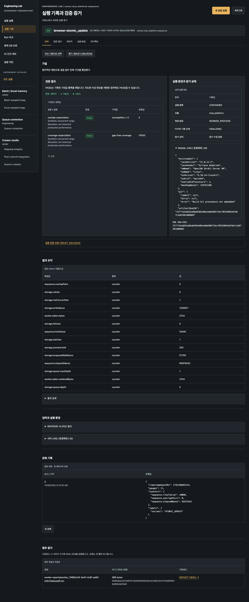
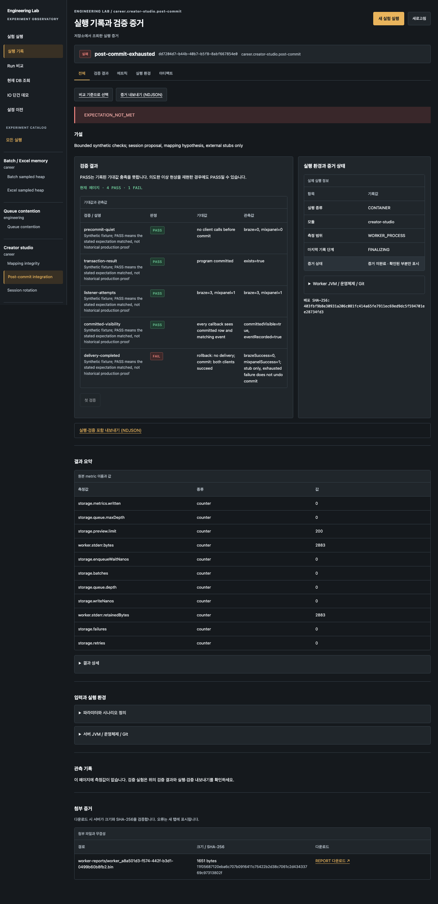

# 전체 모듈 로컬 배포와 인수 검증

D6 이후의 실제 배포 절차다. 기본 앱 설정을 바꾸지 않고 별도 배포 디렉터리에서
기존 세 실험군과 Career 5개 모듈/13개 시나리오를 함께 사용한다. API/프론트엔드는
127.0.0.1에만 bind하며 인증 없는 인터넷 공개 배포를 위한 구성은 아니다.

## 준비

Python 3.11 이상, Java 25/21, Node 24.19.0/npm 11.6.0, Docker와 로컬 캐시 이미지
`eclipse-temurin:21-jre`, `mysql:8.0.39`, `redis:7.4-alpine`이 필요하다.
준비 스크립트는 이미지를 자동 pull하지 않는다. 두 Gradle wrapper는 순차 실행한다.

```bash
./scripts/career-lab.sh test :mcp-platform:sequenceWorkerManifest \
  :mcp-platform:checksWorkerManifest :equity-system:equityWorkerManifest \
  :batch-excel:memoryWorkerManifest :mds-distribution:mdsWorkerManifest \
  :creator-studio:creatorWorkerManifest
./gradlew test bootJar
(cd frontend && npm test && npm run build)
python3 scripts/test-local-deployment.py
python3 scripts/prepare-local-deployment.py .lab/deployments/local-20261016
```

새 디렉터리만 허용한다. manifest의 버전·Java·모듈·파일명·hash를 먼저 검증한 후,
캐시 JRE image ID에서 시작하지 않는 임시 컨테이너를 만들고 `/opt/lab/worker.jar`를
복사해 여섯 이미지를 commit한다. BuildKit/원격 base 조회는 사용하지 않는다.
소유권·base·상태를 대조한 임시 컨테이너만 제거한다. `*-builder.json`이 생성/정리
기록이며, 오류 시 불완전한 디렉터리를 보존한다. 공유 이미지나 컨테이너를 prune하지 않는다.

완료 시 다음 파일을 보존한다.

- `application.properties`: 13개 Career CONTAINER 등록, image ID/hash, opt-in 복구,
  독립 storage root, API 18088. 기본 redirect는 false.
- `deployment.json`: 기반 이미지/worker 이미지 ID·태그·jar hash·controller hash.
- `controller.jar`, `frontend/dist/`, `frontend/server/serve.mjs`: 빌드 산출물의 사본.
- `store/`: 기동 후 Run DB·CHECK·REPORT·workspace/복구 journal.

완료 표시인 application.properties는 모든 이미지와 사본 준비 후에만 생성한다.
여섯 배포 이미지는 재시작에 필요하므로 인수 검증 후에도 유지한다. `build/`를 지워도
배포 파일은 남지만 `.lab`을 지우면 배포와 실행 증거가 함께 삭제된다.

## 시작과 정지

각각 별도 터미널에서 foreground로 실행한다.

```bash
python3 scripts/run-local-deployment.py .lab/deployments/local-20261016 api
python3 scripts/run-local-deployment.py .lab/deployments/local-20261016 frontend
```

- 대시보드: http://127.0.0.1:4188/app/experiments
- API: http://127.0.0.1:18088/dashboard/v1/modules
- 다른 포트: 준비 시 `--port`, frontend 시작 시 `--frontend-port`.
- API Java는 `LAB_JAVA25_HOME`, macOS의 Java 25 자동 탐색, 그 외 PATH 순서로 선택한다.
  frontend는 PATH의 Node를 사용한다. controller jar는 시작 전에 hash를 다시 검사한다.
- 각 터미널의 Ctrl-C로 해당 구성요소만 정지한다. 같은 명령으로 같은 저장소를
  재개방한다. 동시에 두 API가 같은 저장소를 열지 않는다.

배포 교체는 실행을 종료한 뒤 새로운 디렉터리로 준비한다. 기존 store 이관/백업은
[저장 가이드](run-storage.md)를 따른다. 자동 보존 삭제·볼륨 hard quota는 없으며
[D6 운영 제한](dashboard-operations.md)을 유지한다.

## 인수 검증

```bash
python3 scripts/accept-local-deployment.py \
  --output .lab/deployments/local-20261016/acceptance
```

catalog에서 정확히 Career 13개가 준비됐는지 확인한 뒤 기존 시나리오 파일을 순차
접수한다. 정상 13개와 architecture 위반/memory 측정 후 실패/MDS 처리 실패/Creator
재시도 소진 4개를 실행한다. FAILED가 기대인 네 실행을 성공 Run으로 바꾸지 않는다.
Java 21/CONTAINER·증거 완료 상태·CHECK·REPORT byte/hash·확장 export를 대조하고
실행별 JSON과 index를 저장한다. 16 MiB metadata, 1 MiB export line,
100,010 export records, 실행당 1,000초 대기로 검증 도구 자체도 제한한다.
접수/전송이 불확실하게 실패하면 새로 재실행하기 전에 API Run 목록을 조사한다.
기존 출력 디렉터리는 덮어쓰지 않으며 동일 요청 자동 재시도도 하지 않는다.

API를 Ctrl-C로 종료하고 같은 명령으로 다시 시작한 다음:

```bash
python3 scripts/accept-local-deployment.py \
  --output .lab/deployments/local-20261016/acceptance --verify-reopen
```

재실행 없이 동일 Run 17개의 저장된 JSON·REPORT·canonical export hash를 대조한다.
JSON object key 순서는 의미 없는 차이이므로 정렬해 비교한다.

저장된 17개 실행을 실제 서버에서 조회하고 CHECK·REPORT 브라우저 다운로드 hash와
모바일 overflow를 확인한다. 이 테스트는 API 응답을 대체하지 않는다.

```bash
cd frontend
DASHBOARD_URL=http://127.0.0.1:4188 \
  DEPLOYMENT_ACCEPTANCE=../.lab/deployments/local-20261016/acceptance \
  npm run test:e2e -- local-deployment.spec.ts
```

별도 frontend/에서 실제 sequence 브라우저 검증:

```bash
DASHBOARD_URL=http://127.0.0.1:4188 CAREER_E2E=1 \
  npm run test:e2e -- career.spec.ts --grep 'real Career'
# browser-before/browser-atomic-update Run ID를 /runs에서 확인한 뒤 API 재시작
DASHBOARD_URL=http://127.0.0.1:4188 CAREER_REOPEN_IDS='<before-id>,<atomic-id>' \
  npm run test:e2e -- career.spec.ts --grep 'stored Career'
```

인수 검증 중에는 다른 실행을 접수하지 않는다. worker는 전체 실행과 배타적이므로
동시 접수가 허용되지 않는다. 기존 실험의 browser 회귀는 worker 실행 완료 후 수행한다.

## 실제 인수 결과 — 2026-10-16

`local-20261016` 배포에서 engineering 3개와 Career 5개 모듈, 총 16개 실험을
활성화했다. Career 13개 모두 READY/CONTAINER였으며 아래 검증을 통과했다.

| 검증 | 결과 |
| --- | --- |
| 빌드·회귀 | 루트 385건(전체 test 명령, 기존 결과 UP-TO-DATE), Career 150건, frontend unit 18건·typecheck·build·serve 1건 통과 |
| 준비 도구 실패 경계 | jar 변조/경로 탈출, 기존 배포 덮어쓰기, 소유권 불일치 정리 거절 3건 통과 |
| 실제 API 실행 | 13개 정상 + 4개 기대 FAILED, 총 17건 통과; CHECK 67개·REPORT 17개 검증 |
| 실제 브라우저 | 기존 Excel/queue/IO·URL/설정 이전·sequence 실행/비교·17개 REPORT 다운로드 등 18개 테스트 통과(수정 후 재검 포함) |
| API 재시작 | 정상 종료 후 같은 배포/저장소로 재기동; 17개 JSON·REPORT byte/hash·canonical export hash 동일 |
| 재시작 후 브라우저 | sequence 2개 Run 조회/비교와 전체 17개 증거/다운로드, 2개 테스트 통과 |
| 자원 정리 | 인수 17개 + browser sequence 2개 Run의 컨테이너·네트워크 잔여 0; 이미지 조립 컨테이너 6개 제거 |

기존 catalog 브라우저 테스트의 고정 `3 modules` 가정이 활성화된 8개 모듈에서
실패해 필수 engineering 모듈의 포함 여부와 전체 readiness를 검사하도록 수정했다.
해당 테스트는 재실행해 통과했다. D6에서 제외했던 실제 sequence 실행/재시작 테스트도
이번 배포에서 실행했다. 정상 종료/재개방 인수이며 강제 종료·daemon 장애 시험을
대체하지 않는다. 그 검증은 [기존 실패 주입 표](worker-fault-injection.md)를 따른다.

로컬 증거는 배포 디렉터리의 `acceptance/index.json`, 실행별 JSON, `reopen.json`,
`browser-run-ids.txt`, `cleanup-verification.json`에 있다. 배포 이미지 6개와 store는
재사용을 위해 보존했다. 실제 image ID/hash와 Run ID는 로컬 산출물에 기록하며
다른 PC에서 그대로 재사용할 설정값으로 Git에 넣지 않는다.

실제 sequence 실행의 Java 21/CONTAINER, CHECK와 REPORT:



의도적 post-commit 재시도 소진의 FAILED·부분 증거·다운로드:


