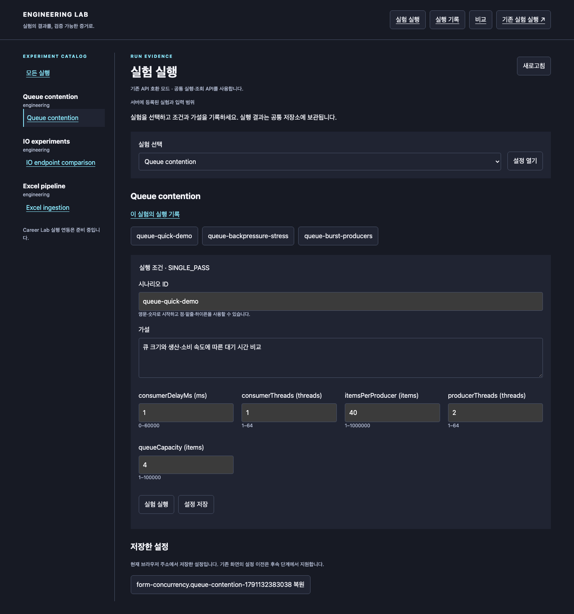
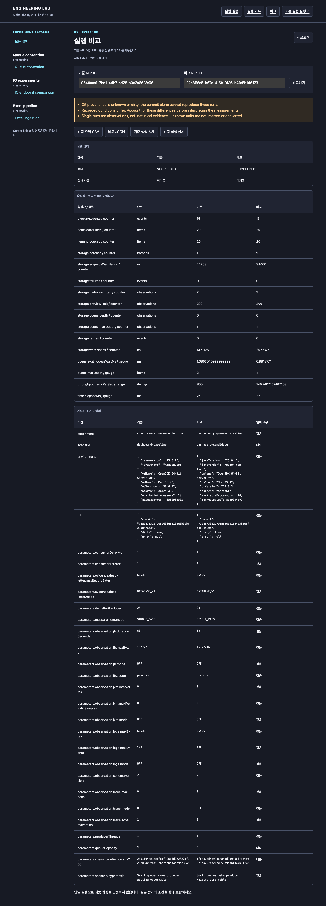
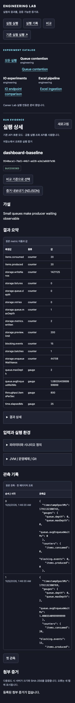
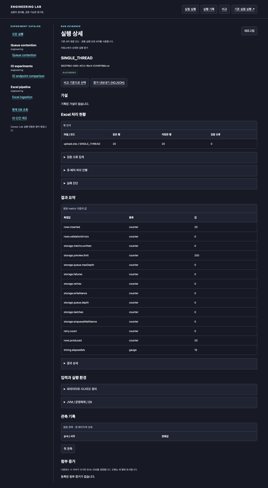
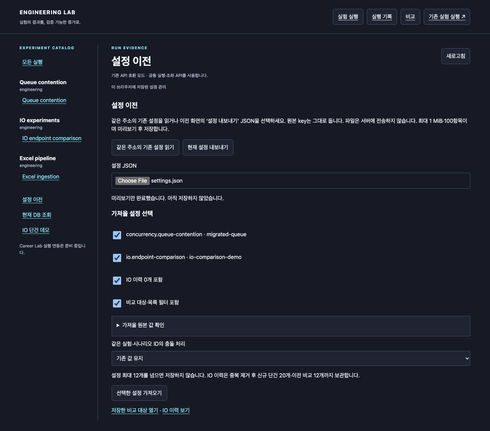
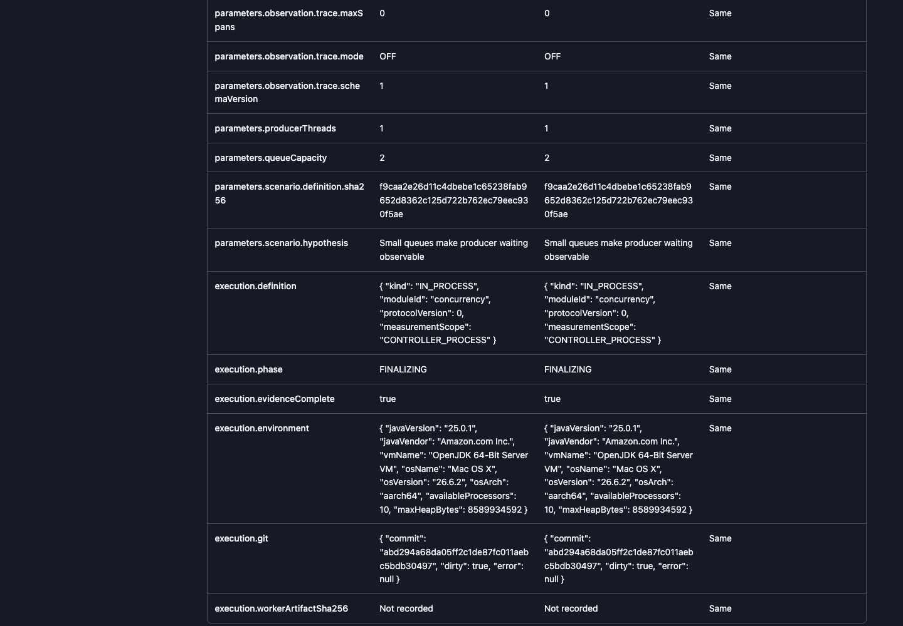
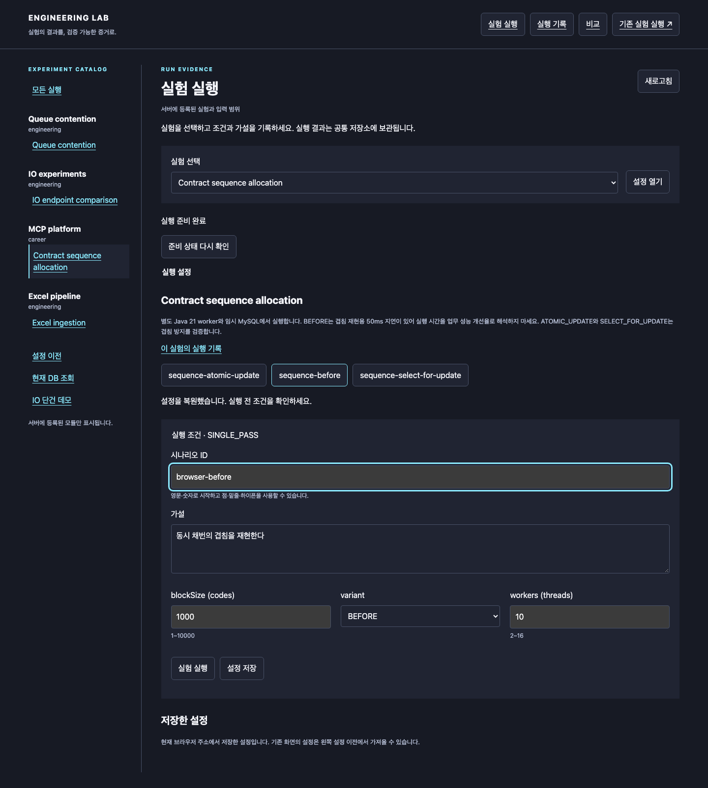
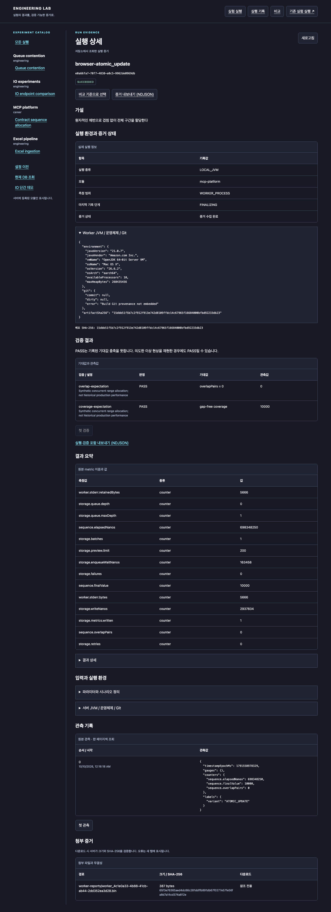

# 독립 대시보드 사용 가이드

2026-10-10 기준 기존 실험 화면에 Career sequence 실행·검증 결과 조회를 추가했습니다. 기존 API 서버와 별도로 실행하며 실험 실행과 Run 증거 조회를 제공합니다.
설치·명령·검증은 [frontend 안내](../frontend/README.md)를 참고하세요.

## 시작과 조회

1. 루트에서 `./gradlew bootRun`으로 기존 API를 실행합니다.
2. Node 24.19.0 환경에서 `frontend/`로 이동해 `npx --yes npm@11.6.0 ci`, `npm run dev`를 실행합니다.
3. `http://127.0.0.1:5173/app/runs`를 엽니다.
4. **실험 실행** 또는 왼쪽 catalog에서 큐·IO 실험을 선택합니다. Excel도 catalog에서 선택해 파일을 업로드합니다.
5. 실행 기록에서 시나리오명을 누르면 상세로 이동합니다. 실험 설정의 **이 실험의 실행 기록**은 해당 실험만 조회합니다.

목록에는 서버가 저장한 실행만 표시합니다. Career sequence는 서버에서 선택적으로 활성화한 경우 catalog에 표시됩니다.
현재 서버는 지원 기능 API를 제공합니다. 구버전 서버 또는 지원하지 않는 기능 명세 버전에서는 **기존 API 호환 모드**로 표시되며 기존 실행·조회 기능을 사용할 수 있습니다. 서버 장애는 호환 모드로 숨기지 않고 오류로 표시합니다.

## 큐·IO 실행과 설정 저장

1. `/app/experiments`에서 실험을 선택하고 **설정 열기**를 누릅니다. 선택한 실험은 URL에 남습니다.
2. 기본 프리셋을 고르거나 서버가 표시한 범위 안에서 파라미터를 입력합니다. 기존 큐 3개·IO 3개 프리셋의 수치는 그대로입니다.
3. 시나리오 ID와 가설을 입력합니다. ID는 영문·숫자로 시작하는 200자 이내 영문·숫자·점·밑줄·하이픈입니다.
4. **설정 저장**은 실행하지 않고 현재 주소의 브라우저 저장소에 최근 12개를 보관합니다. 같은 실험·ID는 덮어쓰며 **복원** 후 다시 실행할 수 있습니다.
5. **실험 실행**을 한 번 누르고 **접수된 실행 상세 보기**로 이동합니다. 접수는 완료를 의미하지 않으며 최종 상태를 확인합니다.

기존 개별 실행 API 대신 공통 `POST /runs`를 사용하므로 가설과 정의 hash도 Run에 기록됩니다.
매번 실행은 새 Run을 만듭니다. 접수 중 버튼은 비활성화됩니다. 통신 오류나 5xx로 접수 여부가 불명확하면 자동 재시도하지 않고 **실행 기록 확인** 링크를 제공합니다.
설정 저장을 브라우저에서 차단해도 실행할 수 있습니다. 기존 화면의 localStorage/sessionStorage는 변경하지 않습니다.
다른 주소(origin)의 설정을 자동으로 가져오지 않으며, 설정 이전 화면에서 JSON 내보내기/가져오기를 사용합니다.

## 상세와 비교

상세는 상태·가설·원본 summary·파라미터·JVM/Git·페이지별 관측·artifact를 보여줍니다.
**비교 기준으로 선택**을 누른 뒤 비교할 Run ID를 입력하면 조건과 측정값을 나란히 확인합니다.
두 ID가 담긴 URL은 북마크하거나 새로고침해도 같은 비교를 엽니다.
누락값은 미기록으로 표시하며 0이나 성능 향상으로 추정하지 않습니다.

비교 화면의 **비교 요약 CSV**는 Run ID·상태·주의사항·조건·측정값·단위를 저장합니다.
누락값은 빈 셀, 실제 0은 0으로 구분합니다. UTF-8 BOM과 실제 줄바꿈을 사용하고 수식으로 해석될 수 있는 문자열은 작은따옴표로 보호합니다.
**비교 JSON**은 서버 비교 응답을 그대로 저장합니다. 새 CSV는 기존 화면의 시계열 CSV와 열 구성이 다릅니다.
전체 시계열은 각 Run의 NDJSON 증거로 보관하며, 기존 시계열 CSV가 필요하면 기존 실험 화면을 이용합니다.

## 내보내기와 작은 화면

종료 Run에서 **증거 내보내기 (NDJSON)**를 선택합니다. 전체 관측을 보관하려면 마지막 `end` 레코드와 개수를 확인합니다.
관리되는 JFR/log는 서버의 크기/hash 검증을 거쳐 다운로드되며, 일반 artifact는 참조 전용입니다.
실행 중이거나 크기 제한을 넘는 artifact에는 다운로드를 제공하지 않습니다.

375px 화면에서도 표·버튼을 사용할 수 있으며 키보드의 첫 Tab은 본문 이동 링크입니다.

## 오류와 지원 범위

- 404: Run ID와 연결한 API 서버를 확인합니다.
- 서버 오류: 화면의 오류 문구를 확인하고 **다시 시도**를 누릅니다. 오류를 빈 성공 화면으로 처리하지 않습니다.
- 빈 목록: 아직 Run이 없거나 선택한 실험/페이지에 데이터가 없습니다.
- 기존 주소는 설정을 켜면 새 화면으로 전환합니다. `legacy=true`로 이전 화면을 열 수 있습니다. 기존 화면과 원본 저장 key는 유지합니다.

## 캡처 재현 정보

Playwright로 실제 API에 `dashboard-baseline`/`dashboard-candidate` 큐 실험을 제출해 촬영했습니다.
producer/consumer 각 1개, 입력 20개, 소비 지연 1ms, queue capacity 2/4를 사용했습니다.
개발 중 dirty 코드 상태와 합성 입력으로 만든 UI 검증용 Run이며 성능 Finding이 아닙니다.
API는 전용 임시 DB를 사용했고 데스크톱 1440px/모바일 375px에서 검증했습니다.
`DOC_SCREENSHOTS=1 npm run test:e2e`로 재촬영할 수 있습니다.

## Excel 업로드와 처리 현황

`/app/experiments?experiment=pipeline.excel-ingestion`에서 비어 있지 않은 XLSX(최대 50 MiB)를 선택하고 PIPELINE 또는 SINGLE_THREAD로 실행합니다. 서버의 업로드 제한이 더 작으면 그 제한을 따릅니다. 기존 `/ingest/excel` API를 사용하므로 큐·배치·재시도 설정은 서버 기본값이며, 업로드 파일은 브라우저 설정에 보관하지 않습니다. 접수 링크를 누르면 같은 Run ID의 상세로 이동합니다.

상세의 **Excel 처리 현황**에서 파일·모드·읽은 행·저장한 행·검증 오류를 확인하고, 오류 집계와 큐·배치 진행 원본을 펼칩니다. 실패 진단과 공통 관측·NDJSON 내보내기도 함께 제공됩니다. 실행 중 2초 간격으로 현재 현황을 갱신합니다. 오류·통신 단절 시 자동으로 파일을 다시 제출하지 않으며 먼저 Excel 실행 기록을 확인합니다.

## 현재 DB와 IO 단건 도구

- **현재 DB 조회**(`/app/tools/ingestion-db`): 최신 1–2000행(기본 200)과 전체 건수를 조회합니다. 모든 작업이 공유하는 현재 테이블이며 특정 Run의 증거가 아닙니다. 건수와 행 조회는 동시 트랜잭션이 아니므로 실행 중 차이가 날 수 있습니다. 데이터를 삭제하지 않습니다.
- **IO 단건 데모**(`/app/tools/io-echo`): 메시지 1–1000자, 지연·pin 지연 각각 0–5000ms로 Virtual thread 또는 Reactive 요청을 보냅니다. 한 번에 한 요청이며 15초 후 응답 대기를 끝냅니다. pin 설정은 Virtual thread 요청에만 적용됩니다.
- 데모는 Run을 생성하지 않습니다. 표시 시간은 브라우저 왕복 시간입니다. 현재 주소의 브라우저에 최근 20개 응답을 저장하고 CSV로 내려받을 수 있습니다. 저장 차단 시 현재 탭에서만 유지하며 오류를 알립니다. 가져온 기존 IO 비교 이력은 평균값 의미를 유지해 별도 영역에 표시합니다. 반복 부하 비교가 필요하면 영속 IO 실험을 사용합니다.

Excel 캡처는 저장소의 생성기로 만든 20행 합성 XLSX를 두 모드로 처리한 브라우저 검증 결과입니다. 테스트 fixture는 `frontend/tests/fixtures/upload.xlsx`이며 실제 사용자 데이터가 아닙니다.

## 브라우저 설정 이전과 백업

`/app/settings` 또는 왼쪽 **설정 이전**을 엽니다.

1. 같은 origin(프로토콜·호스트·포트)의 기존 설정은 **같은 주소의 기존 설정 읽기**로 미리 봅니다.
2. 주소가 다르면 기존 `/experiments/ui`, `/lab/io/ui`, `/runs/ui`의 **설정 내보내기**를 누릅니다. 비교 ID가 sessionStorage에 있으므로 비교 대상을 선택했던 탭에서 내보내세요.
3. 새 화면의 **설정 JSON**에서 파일을 선택합니다. 서버 업로드 없이 이 브라우저에서 검증합니다. 파일은 1 MiB 이하, 설정과 두 종류 IO 이력을 합쳐 최대 100항목입니다. 알 수 없는 실험·잘못된 범위·버전·형식은 저장 전에 거부합니다.
4. 가져올 프리셋과 IO 이력·비교 대상/필터 포함 여부를 선택합니다. 원본 값을 펼쳐 확인하고, 충돌 시 **기존 값 유지** 또는 **선택한 값으로 교체**를 고릅니다. 선택하지 않은 프리셋은 변경하지 않습니다.
5. **선택한 설정 가져오기**를 눌러 저장합니다. 같은 실험·시나리오 ID는 하나로 합치며 총 프리셋 12개를 넘으면 선택을 줄여야 합니다. IO 이력은 중복 제거 후 신규 20개·기존 비교 12개를 유지합니다.
6. 새 화면의 **현재 설정 내보내기**로 통합 JSON을 백업하거나 다른 주소로 다시 옮길 수 있습니다.

원본 localStorage 3개 key와 sessionStorage 비교 ID를 삭제하거나 수정하지 않습니다. 신규 저장은 기존 version 1 프리셋 key에 이력·비교 ID·필터를 추가하는 호환 형식이며 한 번의 저장으로 반영합니다. 저장 공간 부족/차단 시 기존 저장값을 유지하고 오류를 표시합니다. 기존 폼은 ‘저장한 설정’의 복원 버튼으로 다시 열며, 가져온 설정의 가설은 실제 검증할 가설로 수정하세요.

비교 ID와 목록 필터는 URL의 명시적인 값이 저장값보다 우선합니다. **모든 실행**으로 필터를 해제합니다. 가져온 ID에 해당하는 Run이 새 API 서버에 없으면 조회는 404입니다. JSON은 UI 설정과 이력만 옮기며 Run DB·XLSX·서버 파일·인증정보를 옮기지 않습니다. IO의 이전 평균 비교 이력과 신규 단건 왕복 시간은 합산하지 않습니다.

## 배포와 기존 북마크

독립 서버와 내장 jar의 실행, query 보존, 302 전환 및 되돌리기는 [배포 가이드](dashboard-deployment.md)를 참고하세요. 기본은 기존 화면 유지이며 새 `/app` 주소로 직접 접근할 수 있습니다. 내장 배포는 같은 frontend 산출물을 포함한 `bootDashboardJar`가 필요합니다.

## 확장 실행 정보와 기존 화면 호환

현재 서버가 새로 기록한 Run의 비교에는 실행 종류·모듈·측정 범위·증거 완료 상태가 추가됩니다. 기존 `/runs/ui?legacy=true`에서도 같은 조건을 볼 수 있습니다. worker 환경을 아직 기록하지 않았다면 서버 환경으로 대체하지 않습니다. Career sequence와 검증 결과 화면은 아래 절차를 따릅니다.

이 캡처는 임시 DB에서 큐 실험을 실행하고 동일 Run을 양쪽에 선택해 표시 호환을 검증한 결과입니다. 성능 차이를 측정한 자료가 아닙니다. 신규 화면과 실제 구버전 D2 서버(`94c1913`)의 실행·조회·비교·내보내기도 별도로 검증했습니다.

## Career sequence 실행과 검증 결과

1. [배포 가이드](career-worker-deployment.md)대로 worker를 빌드하고 서버에서 sequence 등록을 활성화합니다.
2. 왼쪽 **MCP platform → Contract sequence allocation**을 선택합니다. 준비 상태 확인 중에는 입력·실행이 잠깁니다. Docker 준비 필요나 배포 확인 메시지가 나오면 서버 환경을 수정한 뒤 **준비 상태 다시 확인**을 누릅니다.
3. `sequence-before`, `sequence-atomic-update`, `sequence-select-for-update` 중 프리셋을 선택합니다. workers·blockSize·시나리오 ID·가설을 확인하고 **실험 실행**을 누릅니다.
4. 접수된 실행 상세로 이동합니다. **실제 실행 정보**에서 실행 종류·측정 범위·마지막 기록 단계·증거 완료 여부를 봅니다. Worker JVM/Git/배포 SHA-256은 아래의 서버 JVM/Git와 별도입니다. 미기록 worker를 서버 환경으로 대신 표시하지 않습니다.
5. 종료 후 **검증 결과**에서 PASS/FAIL·기대값·관측값을 확인합니다. BEFORE는 겹침 재현이 기대 결과이므로 PASS가 결함이 없다는 뜻은 아닙니다. 실패 실행은 확인된 부분 증거만 표시하며 빈 결과를 통과로 처리하지 않습니다.
6. **다음 검증**으로 한 페이지씩 조회하거나 **실행·검증 포함 내보내기 (NDJSON)**로 원본을 보관합니다. 비교 화면에서는 측정값 단위와 worker/controller 조건을 함께 확인합니다.

캡처는 임시 저장소와 격리 MySQL에서 실제 실행한 결과입니다. BEFORE의 인위적 50ms 지연 때문에 실행 시간 차이를 업무 성능 개선율로 해석하지 않습니다. 보고서는 중앙에 보관된 참조를 표시하며 다운로드 화면은 후속 범위입니다. Docker/호스트 장애 후 잔여 자원 복구는 아직 보장하지 않습니다.
