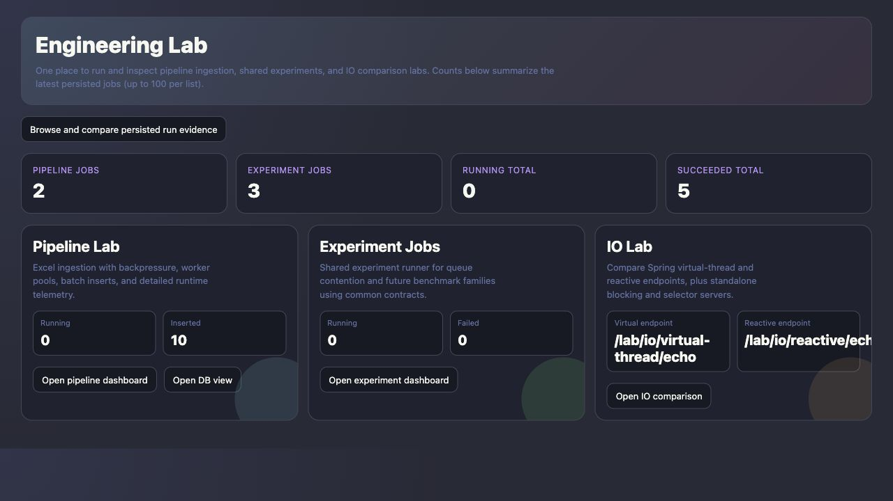
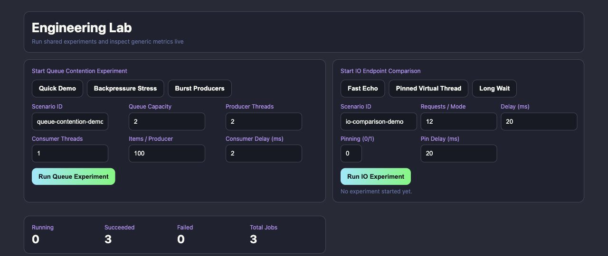
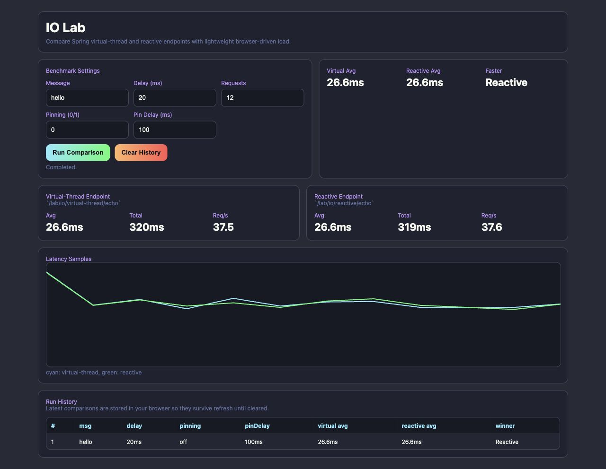
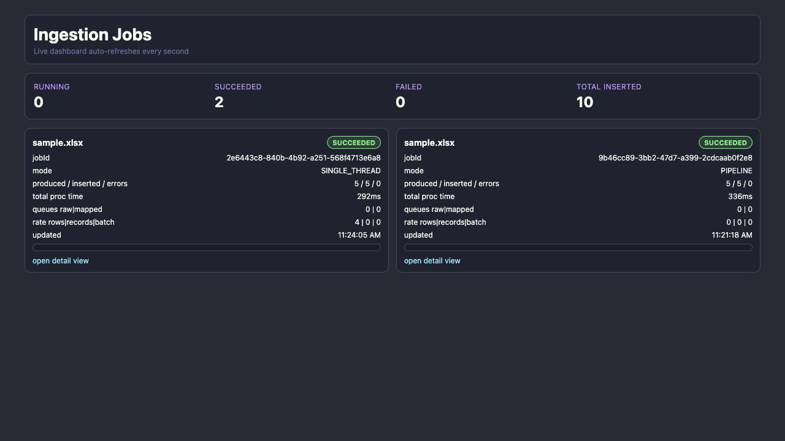
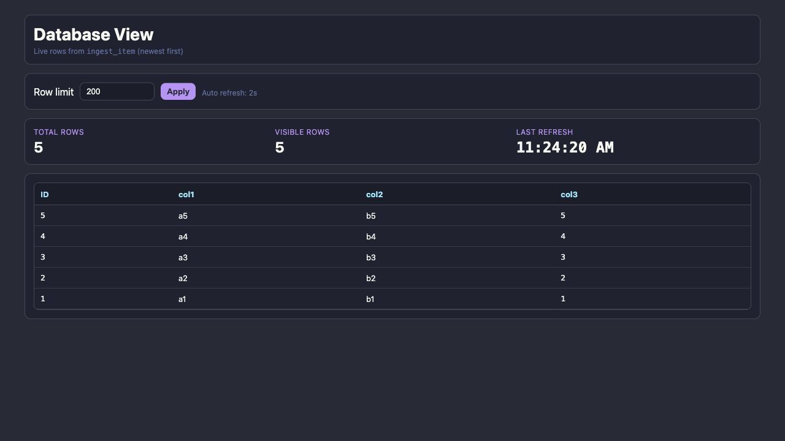
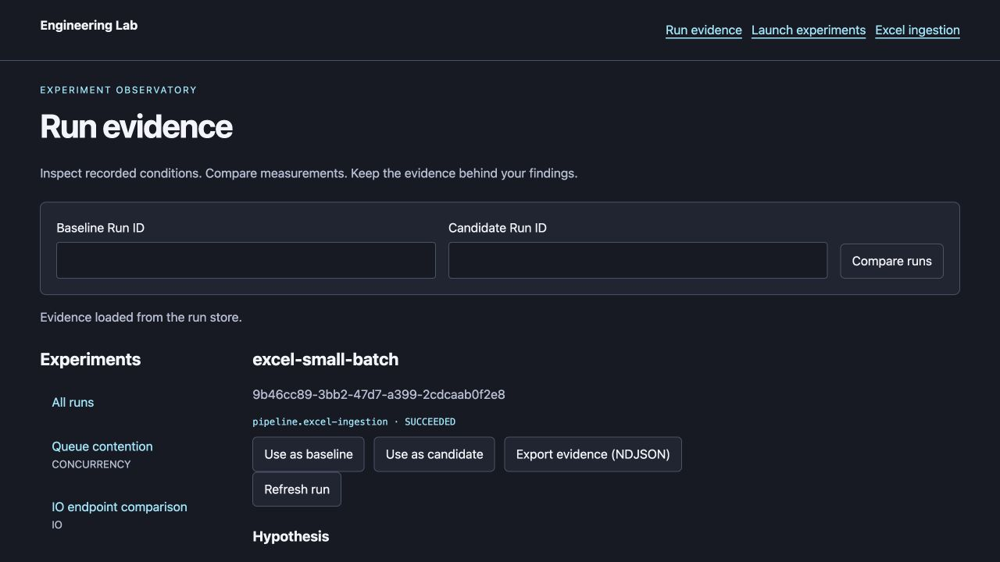
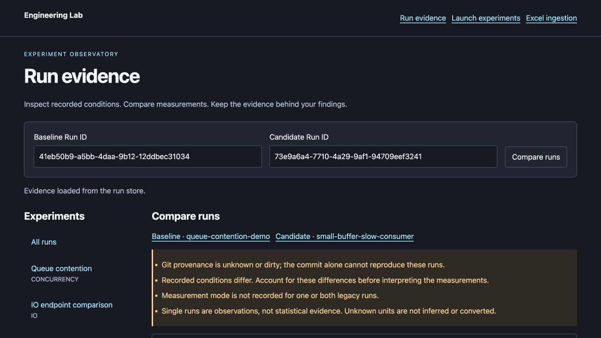
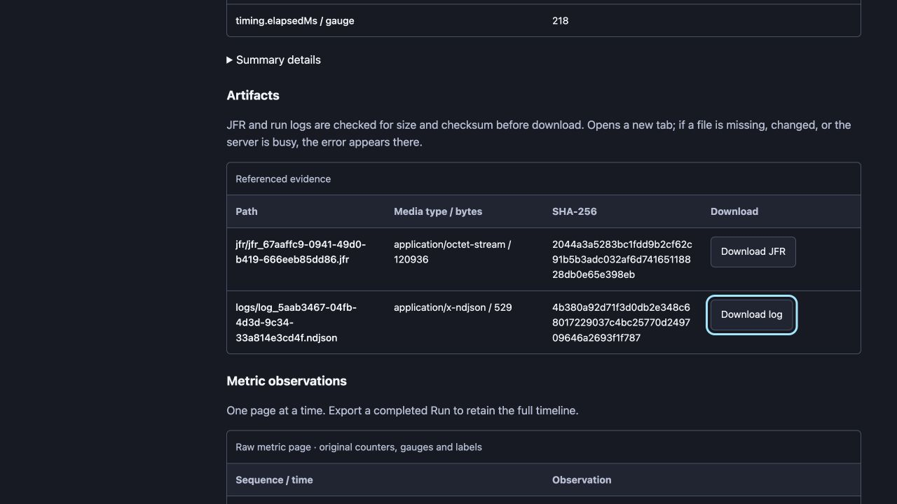

# 화면으로 따라 하는 사용 가이드

[README](../README.md) · [문서 안내](README.md) · [API 참조](api-reference.md) · [문제 해결](operations.md)

이 가이드는 서버 시작부터 실험 실행, 두 결과 비교, 증거 내보내기까지 안내합니다. 캡처는 **2026-10-04 실제 로컬 앱**에서 합성 데이터를 실행한 화면입니다. 캡처 속 ID·시각·성능 수치는 예시이며 그대로 재사용하지 않습니다. 화면의 영어 버튼 이름을 그대로 표기했습니다.

## 1. 서버 시작과 홈

저장소 루트에서 다음을 실행합니다. JDK 25가 필요합니다.

```bash
./gradlew test
./gradlew bootRun --args='--server.address=127.0.0.1'
```

서버를 실행한 터미널은 그대로 두고 [http://localhost:8080/ui](http://localhost:8080/ui)를 엽니다. 기본 화면이 나오면 준비 완료입니다.



- **Open pipeline dashboard**: 이미 제출한 Excel 작업을 확인합니다.
- **Open DB view**: 현재 서버의 입력 데이터 테이블을 봅니다.
- **Open experiment dashboard**: 큐와 IO 실험을 실행합니다.
- **Open IO comparison**: 브라우저에서 직접 endpoint를 호출해 비교합니다.
- **Browse and compare persisted run evidence**: DB에 보존된 Run을 조회·비교합니다.

첫 실행에는 목록과 집계가 비어 있어도 정상입니다. 홈 집계는 최근 작업 목록 기준이며 저장소 전체 통계가 아닙니다.

## 2. 큐 경합 실험 실행

[실험 대시보드](http://localhost:8080/experiments/ui)를 엽니다. 왼쪽 **Start Queue Contention Experiment**에서 다음 값을 사용합니다.

| 입력 | 값 | 의미 |
| --- | ---: | --- |
| Scenario ID | `queue-contention-demo` | 실행 조건을 부르는 이름 |
| Queue Capacity | 2 | 대기 가능한 항목 수 |
| Producer Threads | 2 | 생산자 수 |
| Consumer Threads | 1 | 소비자 수 |
| Items / Producer | 100 | 생산자 한 개가 생성할 항목 수 |
| Consumer Delay (ms) | 2 | 소비 항목별 인위적 대기 |

**Run Queue Experiment**를 누릅니다. 접수되면 `Started <jobId>`가 표시되고, 하단 작업 카드에서 RUNNING → SUCCEEDED를 확인할 수 있습니다. 성공 시 produced/consumed는 각각 200입니다.



**Quick Demo**, **Backpressure Stress**, **Burst Producers**는 입력값을 바꾸는 preset입니다. 적용한 값을 확인한 뒤 실행 버튼을 누릅니다. 최대 큐 깊이·평균 enqueue 대기·blocking 횟수로 소비자가 느릴 때의 배압을 관찰합니다. 차트의 한 번 실행 결과만으로 일반적인 성능 우위를 판단하지 않습니다.

하단 **open metrics**는 실행별 상세 화면입니다. **Compare A/B**와 **Export JSON/CSV**는 legacy 화면의 제한된 preview 비교입니다. 환경·입력 조건과 전체 metric 증거를 비교하려면 다음 Run evidence 화면을 사용합니다. 서로 다른 두 실행을 선택했는지도 확인합니다.

## 3. IO 실험: 저장되는 실행과 간편 비교

### 실행 증거를 남기는 방법

같은 `/experiments/ui` 오른쪽 **Start IO Endpoint Comparison**에서 Requests / Mode=12, Delay=20, Pinning=0, Pin Delay=20으로 **Run IO Experiment**를 누릅니다. 성공하면 virtual/reactive done이 각각 12이며 Run은 저장소에 남습니다.

CLI로도 같은 실험군을 실행할 수 있습니다.

```bash
./gradlew -q lab --args='run experiments/io/endpoint-comparison/scenarios/baseline.json --wait'
```

### 브라우저에서 간단히 비교하는 방법

[IO Lab](http://localhost:8080/lab/io/ui)에서 Message=`hello`, Delay=20, Requests=12, Pinning=0을 입력하고 **Run Comparison**을 누릅니다.



**Completed.** 이후 평균 지연·총 시간·Req/s·표본 차트가 표시됩니다. 이 페이지의 Run History는 브라우저 저장소에만 남고 `/runs/ui`에 새로운 Run을 만들지 않습니다. **Clear History**는 이 브라우저의 간편 비교 이력을 지웁니다.

Pinning 옵션은 synchronized 안의 대기를 켜는 실험 조건입니다. 이름이나 화면의 Faster 표시가 JDK 동작의 원인 분석을 대신하지 않습니다. 브라우저 네트워크 시간과 서버 내부 실험 지표도 측정 범위가 다릅니다.

## 4. Excel 실행

### 포함된 fixture 사용

다른 터미널에서 아래 명령을 실행합니다.

```bash
./gradlew -q lab --args='validate experiments/pipeline/excel-ingestion/scenarios/small-batch.yaml'
./gradlew -q lab --args='run experiments/pipeline/excel-ingestion/scenarios/small-batch.yaml --wait'
```

유효 데이터 5행이므로 최종 summary는 produced=5, inserted=5, validationErrors=0입니다. 접수 응답의 `runId`를 메모합니다.

### 자신의 파일 업로드

A열 필수 문자열, B열 필수 문자열, C열 정수로 첫 시트를 작성하고 첫 행에 헤더를 둡니다. 파일은 `.xlsx`여야 합니다. 작은 샘플을 만들어 실행하려면:

```bash
./scripts/create-test-xlsx.sh build/test-data/sample.xlsx 500
curl --fail --silent --show-error \
  -F 'file=@build/test-data/sample.xlsx' \
  'http://localhost:8080/ingest/excel?mode=PIPELINE'
```

`mode=SINGLE_THREAD`로 바꾸면 단일 스레드 실행입니다. 다시 업로드하면 새 Run을 생성하고 같은 행이 다시 저장될 수 있습니다. `/ingest/ui`에는 업로드 버튼이 없으므로 CLI 또는 이 API를 사용합니다.

### 결과 확인

[Excel 목록](http://localhost:8080/ingest/ui)에서 파일명·모드·상태·produced / inserted / errors를 확인합니다. **open detail view**로 개별 차트를 엽니다.



짧은 실행은 250 ms 진행 표본이 거의 없거나 없을 수 있습니다. 빈 차트나 0 rate만으로 저장 실패를 판단하지 말고 최종 상태와 summary를 확인합니다. `SUCCEEDED`여도 검증 오류가 있을 수 있습니다.

[DB view](http://localhost:8080/ingest/ui/db)는 실제 현재 데이터 테이블입니다. Row limit을 변경하고 **Apply**로 조회 수를 조절합니다.



캡처에서는 과거 Run의 합계 inserted가 10인데 현재 DB는 5행입니다. 중간에 서버를 재시작했기 때문입니다. Run 증거는 파일 DB에 유지되지만 기본 ingestion DB는 메모리 DB여서 재시작하면 초기화됩니다. DB view는 Run별 필터가 아닌 현재 테이블 전체 조회입니다.

## 5. 오류 행 조회

실패 행을 보고 싶다면 샘플 복사본에서 A2를 비우거나 C2를 `not-an-integer`로 바꿔 새로 업로드합니다. 원본 fixture를 수정하면 선언적 시나리오의 checksum도 갱신해야 하므로 이 연습은 위 multipart 업로드로 진행합니다.

실행이 끝나면 반환된 ID를 아래에 넣습니다.

```bash
RUN_ID='실제-run-id'
curl --fail --silent --show-error \
  "http://localhost:8080/runs/$RUN_ID/dead-letters?after=-1&limit=100"
```

`rows`에는 `rowIndex`, `stage`, `reason`, `cells`가 있습니다. rowIndex는 0 기반이므로 실제 Excel 행 번호는 **rowIndex + 1**입니다. `nextAfter`가 있으면 다음 요청의 `after`에 넣어 끝까지 조회합니다. 실행 중 조회는 409입니다. 화면에는 전용 dead-letter 표가 없으며 API를 사용합니다.

preview는 기본 100행까지지만 전체 오류 집계와 영속 오류 행은 별도입니다. 저장소 오류나 행당 64 KiB 초과가 발생하면 Run 자체가 실패합니다.

## 6. Run evidence에서 상세 읽기

[Run evidence](http://localhost:8080/runs/ui)를 엽니다. 왼쪽 실험군을 선택해 필터링하고 오른쪽 시나리오 이름을 누릅니다. **Older/Newest**로 목록 페이지를 이동합니다.


상세는 다음 순서로 읽습니다.

1. **상태**: 성공 여부와 실패 이유를 확인합니다.
2. **Hypothesis**: 선언적 시나리오가 기록한 검증 대상입니다. UI/legacy POST 실행에는 없을 수 있습니다.
3. **Recorded conditions**: Java/OS/heap/CPU와 Git commit·dirty를 확인합니다.
4. **Parameters and canonical scenario**: 펼쳐서 실제 설정·입력 hash·정의를 봅니다.
5. **Summary**: 최종 행 수·오류·재시도 등 집계를 확인합니다.
6. **Artifacts / Metric observations**: 파일과 원본 metric 페이지를 봅니다.



상세는 자동 갱신하지 않습니다. 실행 중에는 **Refresh run**을 누릅니다. 주소의 `?run=<id>`는 같은 evidence 저장소를 사용하는 서버에서 다시 열 수 있습니다. 서버나 저장소가 달라지면 같은 주소의 ID를 찾지 못할 수 있습니다.

## 7. 두 Run 비교

1. baseline으로 사용할 Run 상세에서 **Use as baseline**을 누릅니다.
2. 다른 Run을 열고 **Use as candidate**를 누릅니다.
3. 상단 **Compare runs**를 누릅니다. ID를 입력란에 직접 붙여 넣어도 됩니다.
4. 경고와 **Recorded conditions**의 Different를 먼저 읽습니다.
5. 아래 **Measurements**에서 이름·단위·누락 여부를 확인하고 값을 해석합니다.



캡처는 UI 제출과 선언적 CLI 제출을 비교하므로 시나리오 정의·Git 상태 차이 경고가 있습니다. 화면 오류가 아니라 비교의 전제 조건을 알리는 표시입니다. 문서 작성 중 캡처한 Run은 dirty=true이며, 성능 Finding의 깨끗한 커밋 측정과 구분합니다.

조건이 다른 결과를 곧바로 개선율로 표현하지 않습니다. 같은 입력 checksum·환경·관측 설정으로 비교하고 반복 측정합니다. 이 화면은 자동으로 승자를 정하지 않습니다.

## 8. 증거와 관측 파일 보관

종료된 Run 상세의 **Export evidence (NDJSON)**를 누르면 Run·원본 metric·artifact 참조를 내려받습니다. 마지막 줄에 `type=end`가 있어야 하며 metricCount/artifactCount를 확인합니다. 원본 XLSX·dead-letter 전체·JFR/log 파일은 이 export에 포함되지 않습니다.

JFR·로그는 **실험 실행 전 서버에서 활성화**해야 합니다. 기본 실행에서는 목록이 비어 있는 것이 정상입니다.

```bash
./gradlew bootRun --args='--server.address=127.0.0.1 --lab.observation.jvm-enabled=true --lab.observation.jvm-interval-ms=1000 --lab.trace.enabled=true --lab.jfr.enabled=true --lab.logs.enabled=true'
```

기존 서버를 정상 종료한 뒤 실행하고 새 Run을 만듭니다. 과거 실행의 파일을 소급 생성하지 않습니다.



**Download JFR / Download log**는 파일 크기·checksum을 서버에서 확인한 후 내려받습니다. 새 탭에서 오류가 보이면 [운영 문서](operations.md)의 artifact 항목을 확인합니다. 임의의 사용자 제공 참조에는 다운로드가 지원되지 않을 수 있습니다.

SHA-256 확인 예:

```bash
shasum -a 256 run-evidence.ndjson
# Linux에서는 sha256sum run-evidence.ndjson
```

[Finding 템플릿](findings/TEMPLATE.md)에 가설·조건·Run ID·export 경로/hash·관측·해석·한계를 기록합니다. 캡처는 사용법 설명 자료이며 성능 증거의 원본을 대신하지 않습니다.

## 9. 종료와 다음 실행

서버 터미널에서 `Ctrl+C`를 누르고 종료 로그를 기다립니다. `.lab/`을 유지한 채 같은 위치에서 다시 실행하면 과거 Run을 조회할 수 있습니다. 백업·복원·다른 저장소 사용은 [운영 문서](operations.md)를 참고합니다.

별도 JVM의 반복 측정은 `./gradlew pipelineBenchmark`로 실행하며 [benchmark 가이드](pipeline-benchmark.md)에 측정 범위가 있습니다.

## 캡처 재현 정보

실험 폼은 `119d1a0`의 스크립트 오류 수정 후 캡처했으며 큐·IO 버튼의 실제 성공을 확인했습니다. 홈은 잘못된 gradient 백분율 수정 후 다시 캡처했습니다. 브라우저 기본 화면 폭 1280px에서 원본 페이지를 캡처했고 값이나 경고를 합성하지 않았습니다. 실험 폼은 상단 영역을 잘라 보여주고, 긴 목록/IO 화면은 전체 페이지, 상세/다운로드/비교는 해당 위치의 viewport입니다.

문서용 서버는 기존 `.lab/`과 분리했습니다.

```bash
./gradlew bootRun --args='--server.address=127.0.0.1 --server.port=18080 --lab.storage.root=build/docs-demo --lab.observation.jvm-enabled=true --lab.observation.jvm-interval-ms=1000 --lab.trace.enabled=true --lab.jfr.enabled=true --lab.logs.enabled=true'
```

이 서버를 따라 실행하면 본문의 URL을 18080으로, CLI에 `--server http://127.0.0.1:18080`을 적용합니다. 문서용 데이터는 `build/` 산출물이므로 영구 보관용이 아닙니다. 캡처 파일은 [images](images/)에 저장돼 Git에서 함께 관리됩니다.
